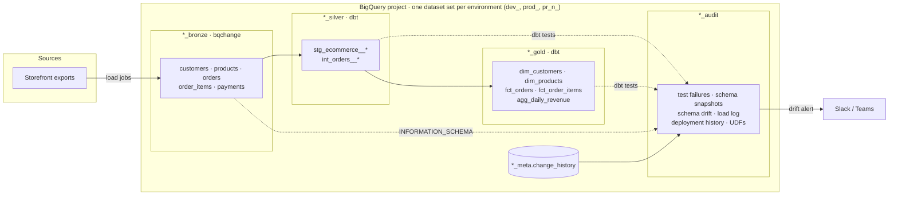
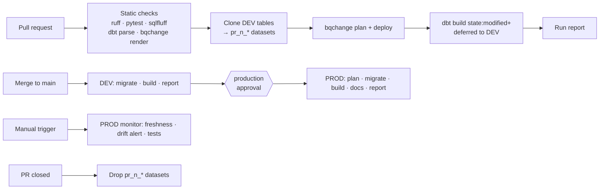

# BigQuery schema migrations + dbt: e-commerce lakehouse

A production-style reference project for **versioned schema management on
Google BigQuery**, using the same approach as
[schemachange](https://github.com/Snowflake-Labs/schemachange) on Snowflake:

- **`bqchange`** (in this repository, `src/bqchange`) owns database objects:
  datasets, landing tables, column changes, UDFs, views and grants, as
  versioned (`V`), repeatable (`R__`) and always (`A__`) SQL scripts with Jinja.
  schemachange itself only supports Snowflake, so `bqchange` brings the same
  conventions to BigQuery and adds a BigQuery-native plan via dry-run jobs.
- **[dbt](https://www.getdbt.com/)** owns the transformations: a medallion
  architecture (BRONZE → SILVER → GOLD) with layered data quality tests,
  enforced contracts and a schema drift audit.
- **GitHub Actions** ties them together: static checks, isolated datasets per
  pull request, gated DEV → PROD deployments and an on-demand data quality
  monitor. Every run publishes a report of schema changes and test results.

Authentication uses **Workload Identity Federation**: no service account key
exists anywhere. Python tooling is managed with [uv](https://docs.astral.sh/uv/).

## Architecture



| Dataset        | Owner    | Content                                                                 |
| -------------- | -------- | ----------------------------------------------------------------------- |
| `<env>_bronze` | bqchange | Source-shaped landing tables, partitioned by load date, with lineage columns |
| `<env>_silver` | dbt      | Typed, cleaned, deduplicated entities; `stg_ecommerce__orders` is an incremental merge |
| `<env>_gold`   | dbt      | Dimensional models with enforced contracts                              |
| `<env>_audit`  | both     | Stored test failures, schema snapshots and drift, load log, UDFs, deployment history |
| `<env>_meta`   | bqchange | `change_history`: one row per applied migration                          |

Environments (`dev`, `prod`, `pr_<number>`) share one GCP project and are
isolated by dataset prefix, set with the `BQ_ENV` variable.

## Repository layout

```
bootstrap/setup_gcp.sh     One-time GCP setup: APIs, service account, Workload Identity Federation
migrations/
  bqchange.yml             Configuration (project, location, history table, vars) rendered with Jinja
  modules/                 Shared Jinja macros
  scripts/versioned/       V<x.y.z>__*.sql  applied once, in version order, immutable afterwards
  scripts/repeatable/      R__*.sql         re-applied when their rendered content changes
  scripts/always/          A__*.sql         applied on every deployment
src/bqchange/              The migration runner (CLI: `bqchange deploy | render`)
dbt/
  models/silver/           Sources (BRONZE), staging and intermediate models
  models/gold/             core (dimensions/facts) and finance (aggregates)
  models/audit/            Schema snapshot history and drift view
  tests/generic|singular/  Custom data quality tests
ops/                       Sample data, loading, pull request environments, drift alerts, run reports
tests/                     pytest suite for bqchange and ops
.github/                   Workflows, composite setup action, Dependabot, CODEOWNERS
docs/                      bqchange reference, runbook and data quality catalogue
```

## Migrations

| Script                                       | Type       | Demonstrates                                     |
| -------------------------------------------- | ---------- | ------------------------------------------------ |
| `V1.0.0__create_medallion_datasets.sql`      | versioned  | Datasets with location, labels and descriptions   |
| `V1.1.0__create_bronze_tables.sql`           | versioned  | Jinja module import, partitioning and clustering  |
| `V1.2.0__add_customer_marketing_consent.sql` | versioned  | Schema evolution (`ALTER TABLE ... ADD COLUMN`)   |
| `V1.3.0__create_load_log.sql`                | versioned  | Operational table in AUDIT                        |
| `R__shared_routines.sql`                     | repeatable | Persistent UDF used by dbt models and tests       |
| `R__audit_views.sql`                         | repeatable | Views over change history and load log            |
| `A__dataset_options.sql`                     | always     | Converging labels; 7-day table expiration on PR datasets |
| `A__grants.sql`                              | always     | Dataset-level `GRANT` for a reader principal      |

```bash
uv run bqchange deploy --dry-run   # plan: pending scripts validated by BigQuery dry runs
uv run bqchange deploy             # apply and record in <env>_meta.change_history
uv run bqchange render versioned/V1.2.0__add_customer_marketing_consent.sql
```

Safety rules enforced by `bqchange` (see [docs/bqchange.md](docs/bqchange.md)):
an applied versioned script can never change, versions cannot be applied out of
order without `--out-of-order`, and every job runs with a `maximum_bytes_billed` cap.

## Data quality

Checks run in layers. See [docs/data-quality.md](docs/data-quality.md) for the full catalogue.

1. **Source tests and freshness** on BRONZE (severity `warn`).
2. **SILVER/GOLD data tests**: uniqueness, referential integrity, accepted
   values, ranges, regex, row-count parity and business rule expressions
   (`dbt_utils`, `dbt_expectations` and custom generic tests).
3. **Singular tests**: revenue reconciliation, payment consistency, schema drift.
4. **Unit tests** for business logic (`fct_orders` totals, customer segmentation).
5. **Contracts** on every GOLD model: column names, types and precision, not null.
6. **Schema drift audit**: `INFORMATION_SCHEMA.COLUMNS` versus dbt source
   declarations, with history in `audit_schema_snapshots` and Slack/Teams alerts.

Failing rows of every test are stored in `<env>_audit`.

## CI/CD



| Workflow         | Trigger                 | What it does                                                        |
| ---------------- | ----------------------- | ------------------------------------------------------------------- |
| `ci.yml`         | pull request            | Offline checks; then migrations and slim `dbt build` in pull request datasets |
| `deploy.yml`     | push to `main`, manual  | DEV, then PROD behind the `production` environment approval; dbt docs artifact |
| `monitor.yml`    | manual                  | Source freshness, schema drift alert and the full data test suite on PROD |
| `pr-cleanup.yml` | pull request closed     | Drops the pull request datasets                                      |

Each run writes a **job summary** with the migrations planned and applied, the
newest BRONZE columns, schema drift and dbt results, so schema changes are
visible directly on the run page. The monitor is manual for this showcase; add a
`schedule` trigger for daily production monitoring.

## Getting started

Requirements: [uv](https://docs.astral.sh/uv/), the
[gcloud CLI](https://cloud.google.com/sdk/docs/install) and a GCP project with
billing enabled (the BigQuery sandbox does not allow the DML used by
incremental models; the demo stays within the free tier).

```bash
make install                                  # uv sync, dbt deps, pre-commit hooks
cp .env.example .env                          # set GCP_PROJECT_ID and BQ_ENV
gcloud auth application-default login         # local credentials, stored outside the repo
make lint test-python                         # everything that runs offline
make migrate-plan migrate sample-data build   # plan, migrate, load and build
make drift docs                               # drift report and dbt docs on localhost
```

Generate broken data on purpose to watch the data quality tests react:

```bash
uv run python -m ops.generate_sample_data --inject-anomalies
```

## GitHub configuration

Run `bootstrap/setup_gcp.sh` once (see [docs/runbook.md](docs/runbook.md)). Workflow
logs of a public repository are public, so every value that identifies the GCP
project is stored as a **secret** and masked in logs.

| Kind        | Name                              | Value                                              |
| ----------- | --------------------------------- | -------------------------------------------------- |
| Secret      | `GCP_PROJECT_ID`                  | Project ID                                         |
| Secret      | `GCP_WORKLOAD_IDENTITY_PROVIDER`  | `projects/<number>/locations/global/workloadIdentityPools/github/providers/github-oidc` |
| Secret      | `GCP_SERVICE_ACCOUNT`             | `bq-ecommerce-cicd@<project>.iam.gserviceaccount.com` |
| Secret      | `SCHEMA_ALERT_WEBHOOK_URL`        | Slack or Teams incoming webhook (optional)          |
| Variable    | `GCP_ENABLED`                     | `true` to run the jobs that need Google Cloud        |
| Variable    | `BQ_LOCATION`                     | Dataset location (default `US`)                     |
| Variable    | `BQ_READER_PRINCIPAL`             | e.g. `group:analysts@example.com` (optional)        |
| Variable    | `FRESHNESS_BLOCKING`              | `true` to fail the monitor on stale sources          |
| Environment | `ci`, `dev`, `production`, `production-monitoring` | Required reviewers on `production` |

## License

[MIT](LICENSE)
