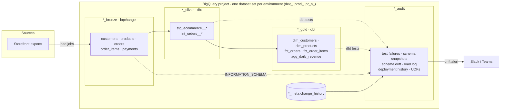
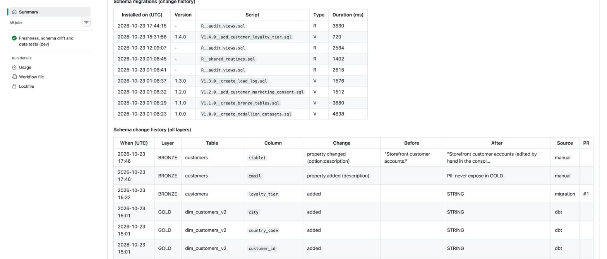
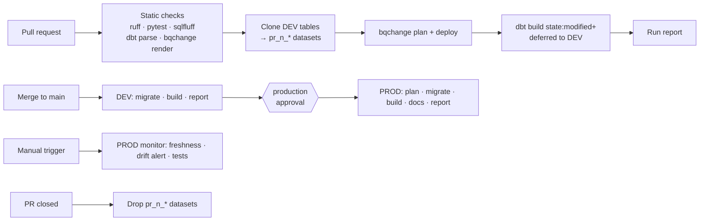

# BigQuery schema migrations + dbt: e-commerce lakehouse

A production-style reference project for **versioned schema management on
Google BigQuery**, using the same approach as
[schemachange](https://github.com/Snowflake-Labs/schemachange) on Snowflake:

- **`bqchange`** (in this repository, `src/bqchange`) owns database objects:
  datasets, landing tables, column changes, UDFs, views and grants, as
  versioned (`V`), repeatable (`R__`) and always (`A__`) SQL scripts with Jinja.
  schemachange itself only supports Snowflake, so `bqchange` brings the same
  conventions to BigQuery and adds a BigQuery-native plan via dry-run jobs.
- **[dbt](https://www.getdbt.com/)** owns the transformations: a medallion
  architecture (BRONZE → SILVER → GOLD) with layered data quality tests,
  enforced contracts and a schema drift audit.
- **GitHub Actions** ties them together: static checks, isolated datasets per
  pull request, gated DEV → PROD deployments and an on-demand data quality
  monitor. Every run publishes a report of schema changes and test results.

> **In a hurry?** Follow the [15-minute quickstart](docs/quickstart.md): install
> bqchange, deploy your first migrations, add a dbt model and see the schema history.
>
> **New to these tools?** Read the [complete guide](docs/guide.md): concepts,
> diagrams, setup with expected outcomes, and screenshots of the quality gate
> blocking real changes. Run-by-run proof is in [docs/evidence](docs/evidence/README.md).

Authentication uses **Workload Identity Federation**: no service account key
exists anywhere. Python tooling is managed with [uv](https://docs.astral.sh/uv/).

## Architecture



| Dataset        | Owner    | Content                                                                 |
| -------------- | -------- | ----------------------------------------------------------------------- |
| `<env>_bronze` | bqchange | Source-shaped landing tables, partitioned by load date, with lineage columns |
| `<env>_silver` | dbt      | Typed, cleaned, deduplicated entities; `stg_ecommerce__orders` is an incremental merge |
| `<env>_gold`   | dbt      | Dimensional models with enforced contracts                              |
| `<env>_audit`  | both     | Stored test failures, schema snapshots and drift, load log, UDFs, deployment history |
| `<env>_meta`   | bqchange | `change_history`: one row per applied migration                          |

Environments (`dev`, `prod`, `pr_<number>`) share one GCP project and are
isolated by dataset prefix, set with the `BQ_ENV` variable.

The medallion layers are not hard-coded: they are declared once in `layers`
(`migrations/bqchange.yml` and `dbt/dbt_project.yml`), so the same tooling works
for staging/marts, Kimball or Data Vault layouts. See the [guide](docs/guide.md#part-4-any-layout-not-only-medallion).

## Repository layout

```
bootstrap/setup_gcp.sh     One-time GCP setup: APIs, service account, Workload Identity Federation
migrations/
  bqchange.yml             Configuration (project, location, history table, vars) rendered with Jinja
  modules/                 Shared Jinja macros
  scripts/versioned/       V<x.y.z>__*.sql  applied once, in version order, immutable afterwards
  scripts/repeatable/      R__*.sql         re-applied when their rendered content changes
  scripts/always/          A__*.sql         applied on every deployment
src/bqchange/              The migration runner (CLI: `bqchange deploy | render`)
dbt/
  models/silver/           Sources (BRONZE), staging and intermediate models
  models/gold/             core (dimensions/facts) and finance (aggregates)
  models/audit/            Schema snapshot history and drift view
  tests/generic|singular/  Custom data quality tests
ops/                       Sample data, loading, pull request environments, drift alerts, run reports
tests/                     pytest suite for bqchange and ops
.github/                   Workflows, composite setup action, Dependabot, CODEOWNERS
docs/                      bqchange reference, runbook and data quality catalogue
```

## Migrations: what they are and when you need one

### The idea

A **migration** is a small SQL file that changes the **structure** of the
database: create a dataset, create a table, add a column. Instead of typing
`ALTER TABLE` in the BigQuery console, you commit the statement as a file. A
tool (`bqchange`) runs each file **once**, in order, in every environment, and
records what it ran in a history table.

Think of it as a numbered logbook: anyone can rebuild an identical database
from an empty project by replaying the pages in order, and everyone can see
when and why each change happened.

### What needs a migration, and what does not

You do **not** write a migration for every table. Only for objects that dbt does
not build:

| Object | Needs a migration? | Why |
| --- | --- | --- |
| Datasets (`dev_bronze`, `prod_gold`, …) | ✅ Yes | They must exist before anything else |
| **Landing / source tables** (BRONZE) | ✅ Yes | They hold data loaded from outside; they cannot be dropped and rebuilt, so their structure changes with careful `ALTER TABLE`s |
| Functions (UDFs), shared views, grants, labels | ✅ Yes (repeatable/always scripts) | Infrastructure that dbt models use but do not own |
| Operations with no SQL (change clustering, copy a table, load a file) | ✅ Yes, as a CLI script (`V1.5.0__recluster.cli.yml` with `bq`/`gcloud` steps) | Same ordering and history as SQL scripts |
| **dbt models** (SILVER, GOLD: `stg_*`, `dim_*`, `fct_*`) | ❌ **No** | dbt creates one table per `.sql` file in `dbt/models/`, named after the file, and rebuilds it on every run. Changing a model = editing its `.sql` and contract |

So your dbt project stays exactly where it is (`dbt/models/...`). The
`migrations/` folder only holds the handful of database scripts listed above.
In this project that is **9 files** for the whole platform, against 15 dbt models.

```
migrations/                      ← database structure, applied by bqchange
  bqchange.yml                   ← configuration (project, layers, history table)
  scripts/
    versioned/  V1.0.0__create_medallion_datasets.sql
                V1.1.0__create_bronze_tables.sql
                ...
    repeatable/ R__shared_routines.sql
    always/     A__grants.sql
dbt/models/                      ← transformations, built by dbt (unchanged)
  silver/  gold/  audit/
```

The `versioned/`, `repeatable/` and `always/` subfolders are only for
readability: bqchange scans everything under `root-folder` and recognises each
file **by its name**, not by its folder.

### Anatomy of a file name

```
V1.2.0__add_customer_marketing_consent.sql
│└─┬─┘└┬┘└──────────────┬─────────────┘└┬┘
│  │   │                │               └─ extension: .sql (or .sql.jinja)
│  │   │                └─ description: free text, words separated by "_"
│  │   └─ separator: two underscores
│  └─ version: numbers separated by "." or "_"
└─ type: V = versioned, R = repeatable, A = always
```

| Type | Name | Runs | Typical content |
| --- | --- | --- | --- |
| **Versioned** | `V<version>__<description>.sql` | **once**, in version order; never edited afterwards | `create schema`, `create table`, `alter table ... add column` |
| **Repeatable** | `R__<description>.sql` | again **whenever the file changes** | `create or replace view`, `create or replace function` |
| **Always** | `A__<description>.sql` | on **every** deployment, last | `grant ...`, `alter schema ... set options (labels ...)` |

**Why a version number?** It fixes the order (a column can only be added after
its table exists) and identifies the change forever. Rules:

- Versions are compared **as numbers**, not text: `V1.10.0` runs after `V1.2.0`.
- Any numeric scheme works: `V1`, `V1.1`, `V2_0`, or dates such as `V2026.10.23.1`.
  This project uses `MAJOR.MINOR.PATCH`; pick one convention and keep it.
- The next migration takes the **next number** after the highest one applied.
  A lower number fails unless you deploy with `--out-of-order`.
- Once applied, a versioned file is **immutable**: bqchange compares its
  fingerprint and refuses to continue if it was edited. To change something,
  add a new version.

### What goes inside each file

Plain BigQuery SQL, one or more statements, with
[Jinja](https://jinja.palletsprojects.com/) placeholders so the same file works in
every environment (`dev_bronze`, `prod_bronze`, `pr_42_bronze`):

```sql
-- migrations/scripts/versioned/V1.2.0__add_customer_marketing_consent.sql
alter table `{{ project }}.{{ env }}_bronze.customers`
add column if not exists marketing_opt_in bool
options (description = 'Customer accepted marketing communication');
```

```sql
-- migrations/scripts/repeatable/R__shared_routines.sql
create or replace function `{{ project }}.{{ env }}_audit.is_valid_email`(email string)
returns bool
as (regexp_contains(lower(trim(email)), r'^[a-z0-9._%+-]+@[a-z0-9.-]+\.[a-z]{2,}$'));
```

Good practice: **one logical change per versioned file**, a description that
says what it does, and `if not exists` / `if exists` so a script is safe to
re-run on a copy of the database. Variables available: `project`, `location`,
`layers` (e.g. `{{ layers.bronze }}`) and everything under `vars` in `bqchange.yml`.

Preview any script without touching BigQuery:

```bash
uv run bqchange render versioned/V1.2.0__add_customer_marketing_consent.sql
```

### The scripts in this project

| Script | Type | Demonstrates |
| --- | --- | --- |
| `V1.0.0__create_medallion_datasets.sql` | versioned | Datasets with location, labels and descriptions |
| `V1.1.0__create_bronze_tables.sql` | versioned | The 5 landing tables; Jinja module import, partitioning and clustering |
| `V1.2.0__add_customer_marketing_consent.sql` | versioned | Schema evolution (`ALTER TABLE ... ADD COLUMN`) |
| `V1.3.0__create_load_log.sql` | versioned | Operational table in AUDIT |
| `V1.4.0__add_customer_loyalty_tier.sql` | versioned | A later column added through a pull request ([#1](https://github.com/flaviobrito/bigquery-schemachange/pull/1)) |
| `R__shared_routines.sql` | repeatable | Persistent UDF used by dbt models and tests |
| `R__audit_views.sql` | repeatable | Views over change history, load log and schema history |
| `A__dataset_options.sql` | always | Converging labels; 7-day table expiration on PR datasets |
| `A__grants.sql` | always | Dataset-level `GRANT` for a reader principal |

```bash
uv run bqchange deploy --dry-run   # plan: pending scripts validated by BigQuery dry runs
uv run bqchange deploy             # apply and record in <env>_meta.change_history
```

### Frequently asked questions

| Question | Answer |
| --- | --- |
| Do I need a migration for each dbt model? | **No.** dbt builds its models. Migrations are only for what dbt does not build (datasets, source tables, UDFs, grants) |
| My tables already exist. Do I script them all? | Only the source tables you want under version control. Write a first migration with `create table if not exists` matching today's structure: on existing environments it changes nothing, on new ones it creates the table |
| Must my SQL files live in a special folder like `dbscripts/`? | Only migrations go under `root-folder` (`migrations/scripts` here, configurable). dbt models, Python and everything else stay where they are |
| Can one file contain several changes? | Yes, it runs as one BigQuery script. Prefer one logical change per file so the history is readable |
| How do I rename or drop a column? | A new versioned script (`alter table ... rename column` / `drop column`), and update the dbt source declaration in the same pull request; the schema drift audit checks they match |
| I made a mistake in an applied migration | Never edit it: write the next version that fixes it (forward fix). See [rollback](docs/runbook.md#4-rollback) |
| What does bqchange record? | One row per applied script in `<env>_meta.change_history` (version, checksum, duration, who, when), plus column-level schema history of every layer in `<env>_meta.schema_change_log` |

The full rule set is in [docs/bqchange.md](docs/bqchange.md); a hands-on walk-through
is the [15-minute quickstart](docs/quickstart.md).

## What bqchange tracks: applied vs observed

bqchange keeps **two different records**. Mixing them up is the most common
misunderstanding, so here they are side by side:

| | **Applied** changes | **Observed** changes |
| --- | --- | --- |
| Command | `bqchange deploy` | `bqchange record-schema --source manual\|migration\|dbt` |
| Question it answers | "Which scripts did bqchange run, when, and by whom?" | "What does every table look like now, and what changed since last time, whoever changed it?" |
| Scope | Only the scripts in `migrations/` | **Every table and view** of the monitored datasets: tables created by migrations, by dbt, or by hand |
| How | Records each script it executes | Reads BigQuery's own catalog (`INFORMATION_SCHEMA`) and compares snapshots |
| Stored in | `<env>_meta.change_history` | `<env>_meta.schema_change_log` (timeline view: `<env>_audit.schema_history`) |

So the monitoring is **not limited to migrations**. A dbt model that gains a
column, or a table someone creates in the console, is recorded exactly like a
migration, with its source:

| Source | Meaning |
| --- | --- |
| `migration` | changed by a bqchange script (recorded right after `deploy`) |
| `dbt` | changed by a dbt model (recorded right after `dbt build`) |
| `manual` | changed outside the pipeline (found before a deployment, or by the monitor) |

### What is detected

| Level | Changes detected |
| --- | --- |
| Table | created, dropped; table type (table / view); **partitioning**; **clustering**; **options**: description, labels, expiration, `require_partition_filter`… |
| Column | added, removed, **type changed** (including precision such as `NUMERIC(18, 2)`); **description** changed |


*A monitor run on DEV after someone edited, in the BigQuery console, the
description of `customers` and of its `email` column: both are reported with the
old and new value and the source `manual`.*



*The accumulated history of the environment: manual metadata changes, a column
added by a migration in pull request #1, and a new dbt model version, in one timeline.*

### What is not covered

| Not monitored | Why / how to include it |
| --- | --- |
| Datasets not declared in `layers` / `schema-log-layers` (here: `<env>_audit`, `<env>_meta`, `billing_export`, anything else in the project) | Only the monitored datasets are snapshotted. Add a dataset to `layers` and `schema-log-layers` to watch it, even one no tool manages |
| Data (row values, counts) | Schema only; data is covered by the [data quality tests](#data-quality) |
| Other GCP projects | One configuration watches one project |
| Properties of a table at the moment it is created or dropped | The table creation/removal itself is recorded through its columns; property changes are tracked from then on |

## Data quality

Checks run in layers. See [docs/data-quality.md](docs/data-quality.md) for the full catalogue.

1. **Source tests and freshness** on BRONZE (severity `warn`).
2. **SILVER/GOLD data tests**: uniqueness, referential integrity, accepted
   values, ranges, regex, row-count parity and business rule expressions
   (`dbt_utils`, `dbt_expectations` and custom generic tests).
3. **Singular tests**: revenue reconciliation, payment consistency, schema drift.
4. **Unit tests** for business logic (`fct_orders` totals, customer segmentation).
5. **Contracts** on every SILVER and GOLD model: column names, types and precision.
6. **Schema drift audit on BRONZE, SILVER and GOLD**: `INFORMATION_SCHEMA.COLUMNS`
   versus dbt sources and model contracts, with history in `audit_schema_snapshots`
   and Slack/Teams alerts. Manual changes in BigQuery are reported before dbt overwrites them.
7. **Schema history for every layer**: `bqchange record-schema` logs each added,
   removed or retyped column and each changed table/column property (partitioning,
   clustering, options, descriptions) of every table in the monitored datasets, with its
   source (migration, dbt or manual), commit and pull request ([details](#what-bqchange-tracks-applied-vs-observed)).
8. **Versioned GOLD models** for breaking changes: `dim_customers` v1 (deprecated,
   still at `dim_customers`) and v2 (`dim_customers_v2`, without the raw email).

Failing rows of every test are stored in `<env>_audit`.

## CI/CD



| Workflow         | Trigger                 | What it does                                                        |
| ---------------- | ----------------------- | ------------------------------------------------------------------- |
| `ci.yml`         | pull request            | Offline checks; then migrations and slim `dbt build` in pull request datasets |
| `deploy.yml`     | push to `main`, manual  | DEV, then PROD behind the `production` environment approval; dbt docs artifact |
| `monitor.yml`    | manual (`dev` or `prod`) | Source freshness, schema drift alert (all layers) and the full data test suite |
| `pr-cleanup.yml` | pull request closed     | Drops the pull request datasets                                      |
| `dq-gate-demo.yml` | manual               | Loads deliberately broken data into a throwaway environment; the quality gate is expected to fail |

Each run writes a **job summary** with the migrations planned and applied, the
newest BRONZE columns, schema drift and dbt results, so schema changes are
visible directly on the run page. The monitor is manual for this showcase; add a
`schedule` trigger for daily production monitoring.

## Quality gate in action

The pipeline is designed to stop bad changes. These cases are reproduced in the
repository's pull requests and workflow runs:

| Change                                                    | Blocked by                                             |
| --------------------------------------------------------- | ------------------------------------------------------ |
| Migration adds a BRONZE column not declared in dbt sources | `assert_no_bronze_schema_drift` (schema drift audit)   |
| Logic bug: order total ignores shipping                    | `fct_orders` unit test and `order_total` expression test |
| Edit of an already applied versioned migration             | bqchange immutability check                            |
| Broken source data (invalid values, orphans, negative prices) | SILVER data tests (`dq-gate-demo.yml`)              |
| Manual `ALTER TABLE` on a SILVER/GOLD table in BigQuery    | Schema drift audit on all layers (`monitor.yml`)      |

## Getting started

Requirements: [uv](https://docs.astral.sh/uv/), the
[gcloud CLI](https://cloud.google.com/sdk/docs/install) and a GCP project with
billing enabled (the BigQuery sandbox does not allow the DML used by
incremental models; the demo stays within the free tier).

```bash
make install                                  # uv sync, dbt deps, pre-commit hooks
cp .env.example .env                          # set GCP_PROJECT_ID and BQ_ENV
gcloud auth application-default login         # local credentials, stored outside the repo
make lint test-python                         # everything that runs offline
uv run bqchange verify                        # configuration, credentials, permissions
make migrate-plan migrate sample-data build   # plan, migrate, load and build
make drift docs                               # drift report and dbt docs on localhost
```

Generate broken data on purpose to watch the data quality tests react:

```bash
uv run python -m ops.generate_sample_data --inject-anomalies
```

## GitHub configuration

Run `bootstrap/setup_gcp.sh` once (see [docs/runbook.md](docs/runbook.md)). Workflow
logs of a public repository are public, so every value that identifies the GCP
project is stored as a **secret** and masked in logs.

| Kind        | Name                              | Value                                              |
| ----------- | --------------------------------- | -------------------------------------------------- |
| Secret      | `GCP_PROJECT_ID`                  | Project ID                                         |
| Secret      | `GCP_WORKLOAD_IDENTITY_PROVIDER`  | `projects/<number>/locations/global/workloadIdentityPools/github/providers/github-oidc` |
| Secret      | `GCP_SERVICE_ACCOUNT`             | `bq-ecommerce-cicd@<project>.iam.gserviceaccount.com` |
| Secret      | `SCHEMA_ALERT_WEBHOOK_URL`        | Slack or Teams incoming webhook (optional)          |
| Variable    | `GCP_ENABLED`                     | `true` to run the jobs that need Google Cloud        |
| Variable    | `BQ_LOCATION`                     | Dataset location (default `US`)                     |
| Variable    | `BQ_READER_PRINCIPAL`             | e.g. `group:analysts@example.com` (optional)        |
| Variable    | `FRESHNESS_BLOCKING`              | `true` to fail the monitor on stale sources          |
| Environment | `ci`, `dev`, `production`, `production-monitoring` | Required reviewers on `production` |

## License

[MIT](LICENSE)
