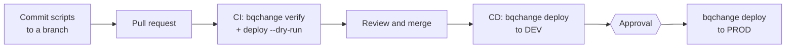

# bqchange

A simple, Python-based tool to manage all of your **BigQuery** objects. It
follows the conventions of [schemachange](https://github.com/Snowflake-Labs/schemachange)
(versioned, repeatable and always scripts, Jinja templates, a change history
table) and adds what BigQuery projects need: dry runs validated by BigQuery, a
per-job cost cap, and a schema history of every table, whoever changed it.

**Contents**

1. [Overview](#1-overview)
2. [Quick start](#2-quick-start)
3. [Project structure](#3-project-structure)
4. [Change scripts](#4-change-scripts)
5. [Change history table](#5-change-history-table)
6. [Authentication](#6-authentication)
7. [Configuration](#7-configuration)
8. [Deployment scenarios](#8-deployment-scenarios)
9. [Commands](#9-commands)
10. [Schema monitoring](#10-schema-monitoring)
11. [Troubleshooting](#11-troubleshooting)
12. [Integrating with CI/CD](#12-integrating-with-cicd)
13. [Comparison with schemachange](#13-comparison-with-schemachange)

---

## 1. Overview

bqchange applies **change scripts** to BigQuery in a deterministic order and
records each one in a **change history table**. Running it again only applies
what is new. Scripts live in Git, are reviewed in pull requests, and the same
files deploy every environment (`dev`, `prod`, pull request copies) thanks to
Jinja variables.

Use it for objects that a transformation tool does not build: datasets, landing
tables, schema evolution (`alter table`), functions, shared views, grants. Leave
dbt models to dbt (see [What needs a migration](../README.md#what-needs-a-migration-and-what-does-not)).

## 2. Quick start

```bash
uv add git+https://github.com/flaviobrito/bigquery-schemachange   # or: pip install git+https://...
gcloud auth application-default login
export GCP_PROJECT_ID=<project> BQ_ENV=dev

uv run bqchange verify             # configuration, credentials, permissions
uv run bqchange deploy --dry-run   # what would run
uv run bqchange deploy             # apply
```

A complete 15-minute walk-through with expected outputs: [quickstart.md](quickstart.md).

## 3. Project structure

```
migrations/
  bqchange.yml                 configuration
  modules/                     optional shared Jinja macros
  scripts/                     root folder: scanned recursively
    versioned/
      V1.0.0__create_datasets.sql
      V1.1.0__create_orders.sql
      V1.2.0__add_order_status.sql
      V1.3.0__recluster_orders.cli.yml
    repeatable/
      R__views.sql
    always/
      A__grants.sql
```

Subfolders are only for readability: bqchange identifies scripts **by file name**.

## 4. Change scripts

### Script types

| Type | File name | When it runs |
| --- | --- | --- |
| Versioned | `V<version>__<description>.sql` | Once, in version order. Never edit it after it ran |
| Repeatable | `R__<description>.sql` | Whenever the rendered file changes, after all versioned scripts |
| Always | `A__<description>.sql` | On every deployment, last |
| CLI | the same prefixes with `.cli.yml` | Same rules as above; runs command-line steps instead of SQL |

Optional `.jinja` suffix: `V1.0.0__orders.sql.jinja`.

### Naming rules

- `V` + version + **two underscores** + description + `.sql`.
- Versions are numbers separated by `.` or `_`, **compared numerically**
  (`V1.10.0` runs after `V1.2.0`). Any scheme works (`V1`, `V2_1`, `V2026.10.23.1`).
- Two scripts cannot share a name or a version.
- Underscores in the description become spaces in the history.

### Script requirements

- Plain BigQuery SQL, one or more statements (run as one BigQuery script job).
- Prefer `create ... if not exists`, `add column if not exists`: scripts stay
  safe on copies of a database.
- One logical change per versioned script.

### CLI migration scripts

Some BigQuery operations have no SQL: changing the clustering of an existing
table, copying tables, loading files, dataset ACLs. List them as steps:

```yaml
# V1.3.0__recluster_orders.cli.yml
steps:
  - bq update --clustering_fields=order_id,customer_id {{ project }}:{{ layers.raw }}.orders
  - command: bq show --format=prettyjson {{ project }}:{{ layers.raw }}.orders
```

- Each step runs **without a shell** (no pipes, redirects or `$VARS`).
- Only executables in `cli-allowed-commands` may run (default `bq`, `gcloud`, `gsutil`).
- A step that fails stops the deployment; nothing is recorded for that script.
- `deploy --dry-run` checks the steps and that each executable is installed, without running them.

### Variables and Jinja

Every script is rendered with Jinja before running. Available variables:

| Variable | Value |
| --- | --- |
| `project`, `location` | From the configuration |
| `layers` | The `layers` map, e.g. `{{ layers.raw }}` → `dev_raw` |
| everything under `vars` | e.g. `{{ env }}` |
| `env_var('NAME', 'default')` | An environment variable |

Shared macros go in `modules-folder` and are imported with
``.

### Secrets

A variable whose name contains `secret` (any case), or any variable under a
`secrets` key, is a secret. Its value is replaced by `****` in logs, `render`
output, `verify`, run summaries and error messages:

```yaml
vars:
  api_secret: "{{ env_var('API_SECRET') }}"
  secrets:
    webhook: "{{ env_var('WEBHOOK_URL') }}"
```

Never write secret values in the YAML file itself; read them from environment variables.

### Common pitfalls

| Pitfall | Result | Do instead |
| --- | --- | --- |
| Editing an applied versioned script | Deployment stops: "Versioned scripts are immutable" | Add the next version |
| A version lower than the latest applied | Deployment stops | Use the next number, or `--out-of-order` deliberately |
| Hard-coded dataset names (`dev_raw`) | Script only works in one environment | `{{ layers.raw }}` or `{{ env }}_raw` |
| A dbt model as a migration | Two owners for one table | Keep models in dbt |

## 5. Change history table

Created automatically (configurable with `create-change-history-table`):

```sql
create table if not exists `<project>.<env>_meta.change_history` (
    version string,              -- null for R and A scripts
    description string,
    script string not null,
    script_type string not null, -- V, R or A
    checksum string not null,    -- SHA-224; raw file for V, rendered file for R and A
    execution_time_ms int64,
    status string not null,
    installed_by string,         -- SESSION_USER()
    installed_on timestamp not null,
    source_checksum string,      -- SHA-224 of the raw file
    script_source string         -- raw file text, used to show diffs
);
```

## 6. Authentication

bqchange uses Google **Application Default Credentials**; no credential ever
goes in the configuration.

| Where | How |
| --- | --- |
| Your machine | `gcloud auth application-default login` |
| GitHub Actions | Workload Identity Federation (`google-github-actions/auth`): short-lived tokens, no key |
| Other CI / servers | Workload Identity, or a service account attached to the runner |

Required roles: `roles/bigquery.jobUser` on the project, plus permission to
create and alter the datasets you manage (`roles/bigquery.dataEditor`, or
`roles/bigquery.dataOwner` to apply `GRANT` statements).

## 7. Configuration

### YAML file (`migrations/bqchange.yml`)

Rendered with Jinja (`env_var()` available), then parsed:

```yaml
project: "{{ env_var('GCP_PROJECT_ID') }}"
location: US
root-folder: scripts
modules-folder: modules
change-history-table: "{{ env_var('BQ_ENV') }}_meta.change_history"
create-change-history-table: true
maximum-bytes-billed: 1073741824
labels: {application: ecommerce}
layers:
  raw: "{{ env_var('BQ_ENV') }}_raw"
  analytics: "{{ env_var('BQ_ENV') }}_analytics"
schema-log-layers: [raw, analytics]
pr-clone-layers: [raw]
cli-allowed-commands: [bq, gcloud, gsutil]
vars:
  env: "{{ env_var('BQ_ENV') }}"
```

| Key | Meaning |
| --- | --- |
| `project` | GCP project that runs the jobs |
| `location` | Dataset and job location (default `US`) |
| `root-folder` | Folder scanned for scripts (relative to the YAML file) |
| `modules-folder` | Shared Jinja templates |
| `change-history-table` | `dataset.table` or `project.dataset.table` |
| `create-change-history-table` | Create it when missing (default `true`) |
| `maximum-bytes-billed` | Jobs that would bill more fail instead of running |
| `labels` | Added to every job |
| `layers` | Logical layer → dataset of this environment |
| `schema-log-layers` | Layers watched by `record-schema` |
| `pr-clone-layers` | Layers copied into pull request environments |
| `cli-allowed-commands` | Executables CLI scripts may run |
| `vars` | Variables for scripts |

### Environment variables and command-line flags

| Flag | Environment variable | YAML key |
| --- | --- | --- |
| `--project` | `BQCHANGE_PROJECT` | `project` |
| `--location` | `BQCHANGE_LOCATION` | `location` |
| `--root-folder` | `BQCHANGE_ROOT_FOLDER` | `root-folder` |
| `--modules-folder` | `BQCHANGE_MODULES_FOLDER` | `modules-folder` |
| `--change-history-table` | `BQCHANGE_CHANGE_HISTORY_TABLE` | `change-history-table` |
| `--maximum-bytes-billed` | `BQCHANGE_MAXIMUM_BYTES_BILLED` | `maximum-bytes-billed` |
| `--vars '{"k": "v"}'` | `BQCHANGE_VARS='{"k": "v"}'` | `vars` (merged) |
| `--config path` | – | – |

### Priority

**Command-line flag > `BQCHANGE_*` environment variable > YAML file.** `vars`
are merged in the same order. The YAML file is optional when `project` and
`change-history-table` come from flags or environment variables:

```bash
bqchange --project my-project --change-history-table meta.change_history \
         --root-folder sql --vars '{"env": "dev"}' deploy
```

## 8. Deployment scenarios

| Scenario | What happens |
| --- | --- |
| Fresh environment | History table created, every script applied in order |
| Up-to-date environment | Only `A__` scripts run |
| A repeatable script changed | It runs again; the summary says `file changed` and shows a diff |
| Same repeatable file, new environment | It runs; reason `re-rendered for <env> (file unchanged)` |
| An applied versioned script edited | Deployment stops before applying anything |
| An older version added later | Stops, unless `deploy --out-of-order` |
| A script fails | Deployment stops; the failed script is not recorded, earlier ones are |

## 9. Commands

| Command | Purpose |
| --- | --- |
| `bqchange deploy` | Apply pending scripts and record them |
| `bqchange deploy --dry-run` | Validate pending scripts (BigQuery dry runs; CLI steps checked) without changing anything |
| `bqchange deploy --out-of-order` | Allow versions older than the latest applied one |
| `bqchange render <path>` | Print a rendered script, secrets masked (offline) |
| `bqchange verify` | Show the resolved configuration (secrets masked) and check credentials, job permission, datasets and the history table |
| `bqchange record-schema --source migration\|dbt\|manual` | Log schema changes of the monitored datasets since the last snapshot |

`verify` output:

```text
Configuration
  project                <project>
  change-history-table   <project>.dev_meta.change_history
  layers                 {'bronze': 'dev_bronze', ...}
  vars                   {'env': 'dev', 'api_secret': '****'}

Checks
  ✅ credentials          user credentials (gcloud auth application-default login)
  ✅ run jobs             dry-run job in <project>
  ✅ layer bronze         dev_bronze
  ⚠️ change history       <project>.dev_meta.change_history will be created by the first deploy
```

Exit code 1 when a check fails (a warning does not fail), so `verify` can gate a pipeline.

When `GITHUB_STEP_SUMMARY` is set, `deploy` and `record-schema` write Markdown
tables (scripts applied with reason and diff, schema changes) to the GitHub
Actions run page.

## 10. Schema monitoring

The change history records what bqchange **applied**. `record-schema` records
what it **observes** in BigQuery's catalog for **every table and view** of the
datasets in `schema-log-layers`, whoever changed them:

| Level | Changes |
| --- | --- |
| Table | created, dropped, table type, partitioning, clustering, every table option (description, labels, partition expiration…) |
| Column | added, removed, type changed, description changed |

Each change is stored in `<env>_meta.schema_change_log` with its source
(`migration`, `dbt` or `manual`), old and new value, commit, pull request, run
and actor. The first run records a baseline. `expiration_timestamp` is ignored
(environment-specific value that changes on every rebuild), and clones are
reported as regular tables. Details and screenshots:
[README](../README.md#what-bqchange-tracks-applied-vs-observed) and
[evidence](evidence/README.md).

## 11. Troubleshooting

| Message | Fix |
| --- | --- |
| `Missing configuration: ['project', ...]` | Set it in the YAML, with `--project` or `BQCHANGE_PROJECT` |
| `Environment variable BQ_ENV is not set` | `export BQ_ENV=dev` |
| `Access Denied: ... bigquery.jobs.create` | `gcloud auth application-default login --project <project>`; `bqchange verify` |
| `Versioned scripts are immutable` | Revert the edit; add the next version |
| `... is older than the latest applied version` | Next version number, or `--out-of-order` |
| `Step N runs 'x', which is not in cli-allowed-commands` | Add `x` to `cli-allowed-commands` if it is legitimate |
| `Executable(s) not found on PATH` | Install the Google Cloud SDK on the runner |
| `Query exceeded limit for bytes billed` | Cost cap working; narrow the query or raise `maximum-bytes-billed` |
| `not validated yet` in a dry run | An earlier pending script creates the object; normal |

## 12. Integrating with CI/CD

### Process flow



### Minimal GitHub Actions workflow

```yaml
# .github/workflows/bqchange.yml
name: bqchange
on:
  pull_request:
    branches: [main]
  push:
    branches: [main]

permissions:
  contents: read
  id-token: write   # Workload Identity Federation

jobs:
  migrate:
    runs-on: ubuntu-latest
    environment: ${{ github.event_name == 'push' && 'production' || 'ci' }}
    env:
      GCP_PROJECT_ID: ${{ secrets.GCP_PROJECT_ID }}
      BQ_ENV: ${{ github.event_name == 'push' && 'prod' || 'dev' }}
    steps:
      - uses: actions/checkout@v4
      - uses: astral-sh/setup-uv@v6
      - uses: google-github-actions/auth@v3
        with:
          workload_identity_provider: ${{ secrets.GCP_WORKLOAD_IDENTITY_PROVIDER }}
          service_account: ${{ secrets.GCP_SERVICE_ACCOUNT }}
      - run: uvx --from git+https://github.com/flaviobrito/bigquery-schemachange bqchange verify
      - name: Plan (pull requests)
        if: github.event_name == 'pull_request'
        run: uvx --from git+https://github.com/flaviobrito/bigquery-schemachange bqchange deploy --dry-run
      - name: Deploy (main)
        if: github.event_name == 'push'
        run: uvx --from git+https://github.com/flaviobrito/bigquery-schemachange bqchange deploy
```

Pin a released commit or tag in production (`...bigquery-schemachange@<tag>`) so
deployments are reproducible. The workflows of this repository add isolated pull
request datasets, dbt, schema monitoring, pull request comments and approvals:
see [`.github/workflows`](../.github/workflows) and the [runbook](runbook.md).

### Other CI systems

bqchange is a command-line tool: any CI that can run Python and authenticate to
Google Cloud works (GitLab CI, Cloud Build, Jenkins, Azure DevOps). Provide
credentials through the platform's workload identity, and pass settings as
`BQCHANGE_*` environment variables or flags.

## 13. Comparison with schemachange

| Feature | schemachange (Snowflake) | bqchange (BigQuery) |
| --- | --- | --- |
| `V`, `R`, `A` scripts, naming, Jinja, modules | ✅ | ✅ |
| Change history table | ✅ | ✅ |
| `deploy`, `render`, `verify`, `--dry-run`, `--out-of-order` | ✅ | ✅ (dry run validated by BigQuery) |
| CLI migration scripts (`.cli.yml`) | ✅ Snowflake CLI | ✅ `bq` / `gcloud` / `gsutil`, allow list |
| Flags > environment > YAML | ✅ | ✅ |
| Secret masking | ✅ | ✅ |
| Applied versioned script edited | warns / optional error | **always stops** |
| Per-job cost cap | – | ✅ `maximum-bytes-billed` |
| Schema history of every table (dbt and manual changes, metadata) | – | ✅ `record-schema` |
| Run summaries, script diffs, pull request comments | – | ✅ |
| `connections.toml` profiles | ✅ | – (Application Default Credentials) |
| PyPI package, Docker image | ✅ | – (install from Git) |
