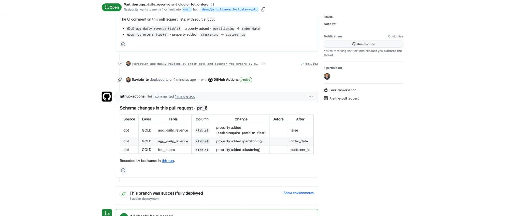

# Metadata changes made in code are shown in the pull request

When a pull request changes how a table is **partitioned** or **clustered**
(here through dbt model configuration), the CI run records the change with
source `dbt` and posts it as a comment in the pull request conversation, before
anything is merged.

[Pull request #8](https://github.com/flaviobrito/bigquery-schemachange/pull/8) ·
[CI run 40015753527](https://github.com/flaviobrito/bigquery-schemachange/actions/runs/40015753527)

## Input

```diff
 -- dbt/models/gold/finance/agg_daily_revenue.sql
+{{ config(partition_by={'field': 'order_date', 'data_type': 'date'}) }}

 -- dbt/models/gold/core/fct_orders.sql
+{{ config(cluster_by=['customer_id']) }}
```

## Expected outcome

The pull request comment lists, with source `dbt`, partitioning added on
`agg_daily_revenue` and clustering added on `fct_orders`.

## Actual outcome ✅

| Source | Layer | Table | Change | After |
| --- | --- | --- | --- | --- |
| dbt | GOLD | agg_daily_revenue | property added (`partitioning`) | `order_date` |
| dbt | GOLD | agg_daily_revenue | property added (`option:require_partition_filter`) | `false` (set by BigQuery when a table is partitioned) |
| dbt | GOLD | fct_orders | property added (`clustering`) | `customer_id` |



## Why this is shown through code

BigQuery cannot change the partitioning column of an existing table in place;
the table must be recreated. dbt recreates models on every build, so changing
`partition_by` in the model is the normal way to do it, and the change is
recorded like any other.
