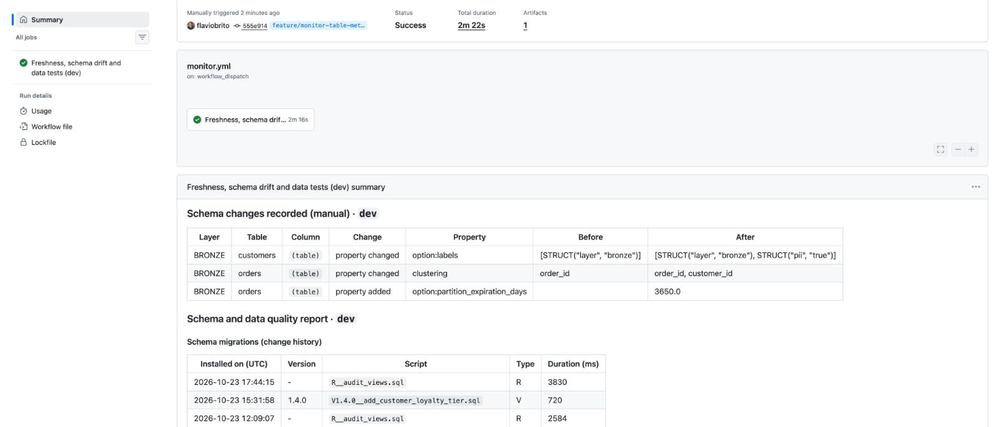
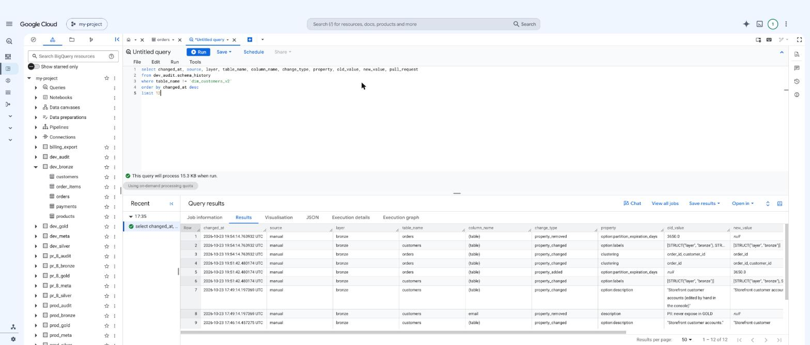

# Metadata changes made by hand are recorded

Table and column **metadata** edited directly in BigQuery (outside Git and the
pipeline) is detected by `bqchange record-schema` and reported with the old and
new value and the source `manual`.

## Round 1: descriptions

[Monitor run 39997646130](https://github.com/flaviobrito/bigquery-schemachange/actions/runs/39997646130) on `dev`.

| Input (BigQuery console) | Recorded as |
| --- | --- |
| `alter table dev_bronze.customers set options (description = 'Storefront customer accounts (edited by hand in the console)')` | `property changed` · `option:description` · before/after |
| `alter table dev_bronze.customers alter column email set options (description = 'PII: never expose in GOLD')` | `property added` · `description` on column `email` |

## Round 2: labels, clustering and partition options

[Monitor run 40014607084](https://github.com/flaviobrito/bigquery-schemachange/actions/runs/40014607084) on `dev`.

| Input (BigQuery console / API) | Before | After | Recorded as |
| --- | --- | --- | --- |
| Labels of `customers`: add `pii=true` | `[STRUCT("layer", "bronze")]` | `[STRUCT("layer", "bronze"), STRUCT("pii", "true")]` | `property changed` · `option:labels` |
| Clustering of `orders` | `order_id` | `order_id, customer_id` | `property changed` · `clustering` |
| `alter table orders set options (partition_expiration_days = 3650)` | – | `3650.0` | `property added` · `option:partition_expiration_days` |

## The same history in BigQuery

*Both rounds (and the restores) as rows of `dev_audit.schema_history`, queried in the BigQuery console.*

## Expected vs actual

| Expected | Actual |
| --- | --- |
| Each manual change reported once, with before/after values and source `manual` | ✅ 2 changes in round 1, 3 changes in round 2 |
| No column drift (only metadata changed), so the monitor stays green | ✅ both runs succeeded |
| Restoring the original metadata is recorded too | ✅ 2 and 3 `manual` changes back to the original values |

## Not covered by this test

Changing the **partitioning column** of an existing table is not possible in
place in BigQuery (the table must be recreated). That change is shown through
code in a pull request, where dbt rebuilds the model: see
[metadata changes made by code](metadata-code-changes.md).
