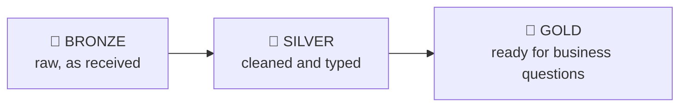
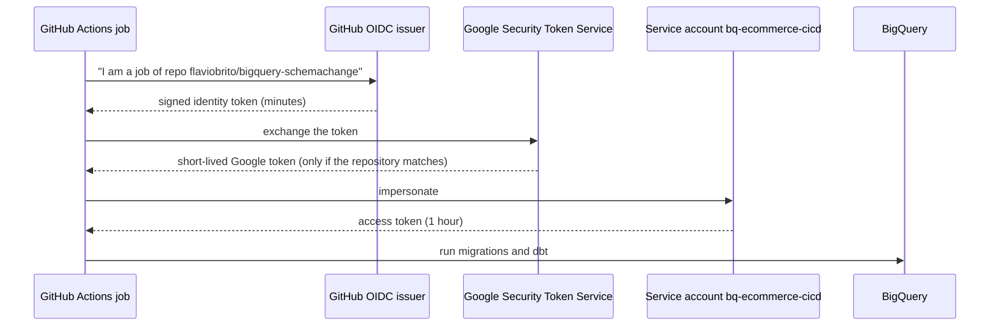
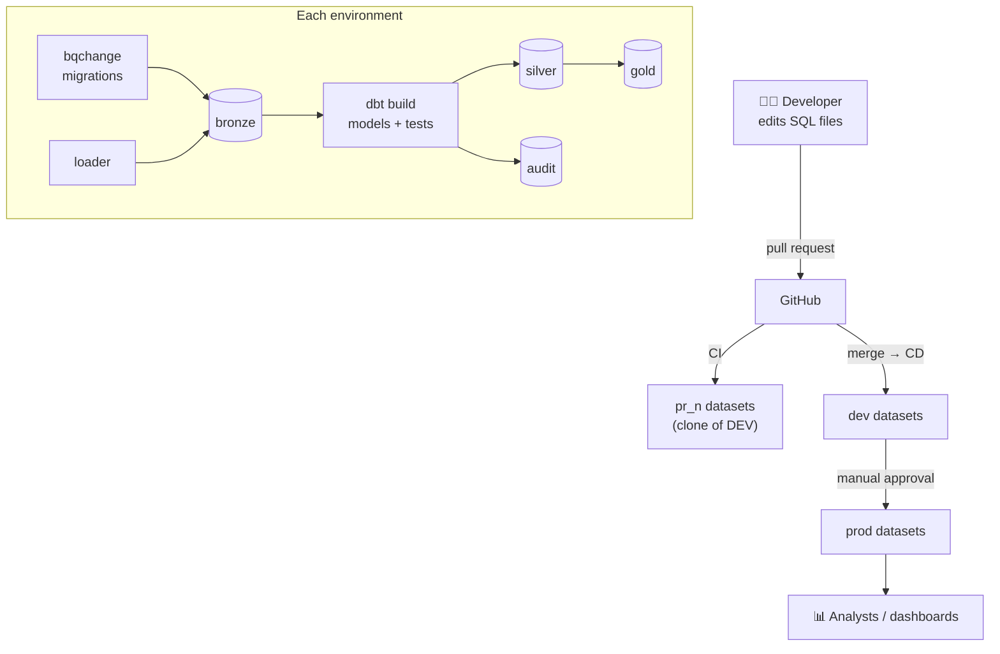

# The complete guide (no prior knowledge required)

This guide explains **what this project does, why, and how to run it**, step by
step. Every step lists what you do (**input**) and what you should see
(**expected outcome**), with screenshots of real runs.

> If you only want the commands, see the [README](../README.md). This document
> is for understanding.

**Contents**

1. [The problem this project solves](#1-the-problem-this-project-solves)
2. [Concepts in plain language](#2-concepts-in-plain-language)
3. [How the pieces fit together](#3-how-the-pieces-fit-together)
4. [One-time setup](#4-one-time-setup)
5. [The pipelines, one by one](#5-the-pipelines-one-by-one)
6. [The quality gate in action: four blocked changes](#6-the-quality-gate-in-action-four-blocked-changes)
7. [Reading the run reports](#7-reading-the-run-reports)
8. [Day-to-day workflow](#8-day-to-day-workflow)
9. [Troubleshooting](#9-troubleshooting)
10. [Glossary](#10-glossary)

---

## 1. The problem this project solves

An online store produces data every minute: new customers, orders, payments.
Analysts want reliable numbers ("how much did we sell yesterday?"), and the
database that holds this data keeps **changing shape**: a new column appears, a
table is added, a rule is updated.

Without discipline, three things go wrong:

| Risk                     | Example                                                        |
| ------------------------ | -------------------------------------------------------------- |
| **Untracked changes**    | Someone adds a column directly in the console; nobody knows when or why. |
| **Broken numbers**       | A formula change silently drops shipping from the revenue total. |
| **Bad data flows through** | An order for a customer that does not exist reaches the dashboard. |

This project shows a production-grade answer:

- every database change is a **reviewed file in Git**, applied automatically and recorded;
- every change is **tested in an isolated copy** before it reaches production;
- a **quality gate** blocks bad structure, bad logic and bad data, and shows why.

---

## 2. Concepts in plain language

### Data warehouse and BigQuery

A **data warehouse** is a database built for analysis rather than for running
the store. **Google BigQuery** is Google Cloud's data warehouse: you store
tables and query them with SQL, and you pay for storage and for the data each
query reads (with a generous free tier).

BigQuery organises tables in **datasets** (folders of tables) inside a **project**
(the billing and permission boundary).

### Medallion architecture (bronze, silver, gold)

Data is refined in layers, like ore turned into jewellery:



| Layer  | What it holds in this project                                      | Who builds it |
| ------ | ------------------------------------------------------------------ | ------------- |
| BRONZE | The store's exports exactly as received, plus where and when each row arrived | migrations + loader |
| SILVER | One clean row per customer, product, order, item and payment       | dbt           |
| GOLD   | Facts and dimensions (orders, customers, daily revenue)            | dbt           |
| AUDIT  | Evidence: test failures, schema history, schema drift, load log    | dbt + migrations |

### Schema and schema migrations

The **schema** is the shape of the data: which tables exist, which columns they
have and their types. A **migration** is a small SQL file that changes the
schema, for example "add the column `marketing_opt_in` to `customers`".

Migrations are numbered (`V1.0.0`, `V1.1.0`, …) and applied **in order, exactly
once**, like the chapters of a book. A **change history table** records which
chapters were already applied, so running the tool twice does nothing the
second time.

[schemachange](https://github.com/Snowflake-Labs/schemachange) is a popular tool
for this on Snowflake. It does not support BigQuery, so this project includes
**`bqchange`**, a small tool with the same rules for BigQuery.

| Script type | Name pattern            | Runs                         | Example                          |
| ----------- | ----------------------- | ---------------------------- | -------------------------------- |
| Versioned   | `V1.2.0__description.sql` | once, in version order       | add a column                     |
| Repeatable  | `R__description.sql`     | whenever its content changes | (re)create a view or function    |
| Always      | `A__description.sql`     | on every deployment          | re-apply labels and permissions  |

Two safety rules: an applied versioned script **may never be edited** (you add a
new one instead), and versions **may not be skipped**.

### dbt

**dbt** (data build tool) turns SQL `select` statements into tables and views,
in the right order, and **tests** them. Each file in `dbt/models` is one table or
view. dbt also:

- generates documentation and a **lineage graph** (which table feeds which);
- runs **data tests** ("this column is never empty", "every order belongs to a customer");
- runs **unit tests** (feed fake rows into a model, compare the output with the expected rows);
- enforces **contracts** (a GOLD table must have exactly these columns and types).

### Data quality and the quality gate

**Data quality** checks are questions with a yes/no answer about the data. A
**quality gate** is a checkpoint that stops the pipeline when an important
check fails, so bad data or bad code never reaches production.

Checks have a **severity**:

| Severity | Meaning                                   | Example                                 |
| -------- | ----------------------------------------- | --------------------------------------- |
| `warn`   | Report it, keep going                     | raw data contains duplicate rows (SILVER removes them) |
| `error`  | Stop: the pipeline fails                  | an order references a customer that does not exist |

### Schema drift

**Schema drift** means the real database and the documented schema disagree. For
example, a column exists in BigQuery but nobody declared it in the dbt project.
This project compares BigQuery's own catalogue (`INFORMATION_SCHEMA`) with the
dbt declarations on every run and fails when they differ.

### Git, pull requests and CI/CD

- **Git** keeps the history of every file. **GitHub** hosts it.
- A **pull request (PR)** proposes a change and lets people (and robots) review
  it before it is merged into the main branch.
- **CI** (continuous integration) automatically checks every PR.
- **CD** (continuous delivery) automatically deploys merged changes.
- **GitHub Actions** runs these automations. Each automation is a **workflow**
  (a YAML file in `.github/workflows`), made of **jobs**, made of **steps**.
- A GitHub **environment** (`dev`, `production`) can require a **manual approval**
  before a job runs. Here, production requires the owner's approval.

### Environments

The same code runs in several isolated copies, distinguished by a dataset prefix:

| Environment  | Datasets           | Purpose                                     | Lifetime          |
| ------------ | ------------------ | ------------------------------------------- | ----------------- |
| `dev`        | `dev_bronze`, …    | First deployment after a merge              | permanent         |
| `prod`       | `prod_bronze`, …   | What analysts use                           | permanent         |
| `pr_<number>`| `pr_7_bronze`, …   | Test one pull request in isolation          | dropped when the PR closes |

Pull request environments start as a **clone** of DEV: BigQuery copies tables
instantly and only charges for data that changes afterwards.

### Workload Identity Federation (keyless authentication)

GitHub Actions must prove to Google Cloud who it is. The old way is a
**service account key**: a password file stored in GitHub, which can leak.

This project uses **Workload Identity Federation (WIF)** instead:



No password or key exists anywhere. Only workflows from **this repository** are
accepted; a fork or another repository is rejected.

---

## 3. How the pieces fit together



What happens inside **every** deployment, in order:

| # | Step                     | Tool       | Input                         | Expected outcome                                  |
| - | ------------------------ | ---------- | ----------------------------- | ------------------------------------------------- |
| 1 | Plan migrations          | bqchange   | `migrations/scripts/**`       | List of pending scripts, each validated by a BigQuery dry run (nothing changes) |
| 2 | Apply migrations         | bqchange   | pending scripts               | Datasets/tables changed; one row per script in `<env>_meta.change_history` |
| 3 | Load data (optional)     | ops loader | CSV files                     | Rows appended to BRONZE; one row per file in `<env>_audit.load_log` |
| 4 | Build and test           | dbt        | `dbt/models/**`, `dbt/tests/**` | SILVER and GOLD rebuilt; ~105 checks run; failures stored in `<env>_audit` |
| 5 | Report                   | ops report | change history, audit tables, dbt results | A Markdown report on the GitHub run page |

---

## 4. One-time setup

> You only do this once. Placeholders such as `<project>` stand for your own values.

### 4.1 Prerequisites

| Need                                   | Why                                    | Check                         |
| -------------------------------------- | -------------------------------------- | ----------------------------- |
| A Google Cloud project with billing    | BigQuery's free "sandbox" forbids the `MERGE` statements used here | `gcloud billing projects describe <project>` shows `billingEnabled: true` |
| `gcloud` CLI, logged in as project owner | Creates the service account and WIF | `gcloud auth list`            |
| `uv`                                   | Installs Python and all tools          | `uv --version`                |
| `gh` CLI with the `workflow` scope     | Stores secrets, pushes workflows        | `gh auth status`              |

**Cost:** the sample data is a few megabytes; queries, loads and clones stay
inside BigQuery's free tier. Every job is capped at 1 GiB billed
(`maximum_bytes_billed`), so a mistake cannot run up a bill.

### 4.2 Local installation

**Input**

```bash
git clone https://github.com/flaviobrito/bigquery-schemachange.git
cd bigquery-schemachange
make install
cp .env.example .env            # then edit GCP_PROJECT_ID
gcloud auth application-default login
```

**Expected outcome:** `make install` ends without errors; `make lint test-python`
prints `All checks passed!` and `46 passed`.

> Your local credentials are stored by `gcloud` in `~/.config/gcloud`, outside
> the repository. `.env` is ignored by Git. Nothing secret is ever committed.

### 4.3 Connect GitHub to Google Cloud

**Input**

```bash
GCP_PROJECT_ID=<project> GITHUB_REPOSITORY=<owner>/<repo> CONFIGURE_GITHUB=true \
  ./bootstrap/setup_gcp.sh
```

**Expected outcome**

```
==> Enabling APIs
==> Service account
Created service account [bq-ecommerce-cicd].
==> Workload Identity Federation
Created workload identity pool [github].
Created workload identity pool provider [github-oidc].
==> GitHub secrets and variables (<owner>/<repo>)
Done. Values are stored as secrets so they are masked in public workflow logs.
```

In GitHub, **Settings → Secrets and variables → Actions** now shows three
secrets (`GCP_PROJECT_ID`, `GCP_SERVICE_ACCOUNT`, `GCP_WORKLOAD_IDENTITY_PROVIDER`)
and one variable (`GCP_ENABLED = true`).

> **Why secrets and not variables?** Logs of a public repository are public, and
> dbt prints full table names (`<project>.dev_silver.…`). GitHub replaces secret
> values with `***` in logs, so the project ID never appears.

> **First run fails with `iam.serviceAccounts.getAccessToken denied`?** New
> permissions take a few minutes to propagate. Wait 3–5 minutes and press
> **Re-run failed jobs**.

### 4.4 Environments and approvals

In **Settings → Environments** create `ci`, `dev`, `production` and
`production-monitoring`. On `production`, tick **Required reviewers**, add
yourself, and under **Deployment branches** allow only `main`.

**Expected outcome:** every production deployment pauses with the message
*"Review pending deployments"* until a reviewer approves.

---

## 5. The pipelines, one by one

<!-- PIPELINES -->

## 6. The quality gate in action: four blocked changes

<!-- SCENARIOS -->

## 7. Reading the run reports

<!-- REPORTS -->

## 8. Day-to-day workflow

<!-- DAILY -->

## 9. Troubleshooting

<!-- TROUBLESHOOTING -->

## 10. Glossary

<!-- GLOSSARY -->
