# The complete guide (no prior knowledge required)

This guide explains **what this project does, why, and how to run it**, step by
step. Every step lists what you do (**input**) and what you should see
(**expected outcome**), with screenshots of real runs.

> If you only want the commands, see the [README](../README.md). This document
> is for understanding.

**Contents**

1. [The problem this project solves](#1-the-problem-this-project-solves)
2. [Concepts in plain language](#2-concepts-in-plain-language)
3. [How the pieces fit together](#3-how-the-pieces-fit-together)
4. [One-time setup](#4-one-time-setup)
5. [The pipelines, one by one](#5-the-pipelines-one-by-one)
6. [The quality gate in action: five blocked changes](#6-the-quality-gate-in-action-five-blocked-changes)
7. [A pull request from opening to closing](#7-a-pull-request-from-opening-to-closing)
8. [Change log: monitoring every layer](#8-change-log-monitoring-every-layer)
9. [Reading the run reports](#9-reading-the-run-reports)
10. [Day-to-day workflow](#10-day-to-day-workflow)
11. [Troubleshooting](#11-troubleshooting)
12. [Glossary](#12-glossary)

---

## 1. The problem this project solves

An online store produces data every minute: new customers, orders, payments.
Analysts want reliable numbers ("how much did we sell yesterday?"), and the
database that holds this data keeps **changing shape**: a new column appears, a
table is added, a rule is updated.

Without discipline, three things go wrong:

| Risk                     | Example                                                        |
| ------------------------ | -------------------------------------------------------------- |
| **Untracked changes**    | Someone adds a column directly in the console; nobody knows when or why. |
| **Broken numbers**       | A formula change silently drops shipping from the revenue total. |
| **Bad data flows through** | An order for a customer that does not exist reaches the dashboard. |

This project shows a production-grade answer:

- every database change is a **reviewed file in Git**, applied automatically and recorded;
- every change is **tested in an isolated copy** before it reaches production;
- a **quality gate** blocks bad structure, bad logic and bad data, and shows why.

---

## 2. Concepts in plain language

### Data warehouse and BigQuery

A **data warehouse** is a database built for analysis rather than for running
the store. **Google BigQuery** is Google Cloud's data warehouse: you store
tables and query them with SQL, and you pay for storage and for the data each
query reads (with a generous free tier).

BigQuery organises tables in **datasets** (folders of tables) inside a **project**
(the billing and permission boundary).

### Medallion architecture (bronze, silver, gold)

Data is refined in layers, like ore turned into jewellery:

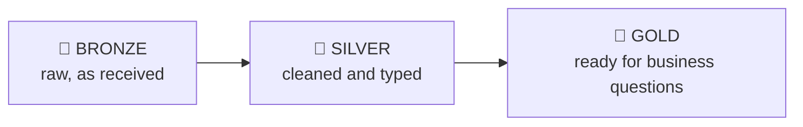

| Layer  | What it holds in this project                                      | Who builds it |
| ------ | ------------------------------------------------------------------ | ------------- |
| BRONZE | The store's exports exactly as received, plus where and when each row arrived | migrations + loader |
| SILVER | One clean row per customer, product, order, item and payment       | dbt           |
| GOLD   | Facts and dimensions (orders, customers, daily revenue)            | dbt           |
| AUDIT  | Evidence: test failures, schema history, schema drift, load log    | dbt + migrations |

### Schema and schema migrations

The **schema** is the shape of the data: which tables exist, which columns they
have and their types. A **migration** is a small SQL file that changes the
schema, for example "add the column `marketing_opt_in` to `customers`".

Migrations are numbered (`V1.0.0`, `V1.1.0`, …) and applied **in order, exactly
once**, like the chapters of a book. A **change history table** records which
chapters were already applied, so running the tool twice does nothing the
second time.

[schemachange](https://github.com/Snowflake-Labs/schemachange) is a popular tool
for this on Snowflake. It does not support BigQuery, so this project includes
**`bqchange`**, a small tool with the same rules for BigQuery.

| Script type | Name pattern            | Runs                         | Example                          |
| ----------- | ----------------------- | ---------------------------- | -------------------------------- |
| Versioned   | `V1.2.0__description.sql` | once, in version order       | add a column                     |
| Repeatable  | `R__description.sql`     | whenever its content changes | (re)create a view or function    |
| Always      | `A__description.sql`     | on every deployment          | re-apply labels and permissions  |

Two safety rules: an applied versioned script **may never be edited** (you add a
new one instead), and versions **may not be skipped**.

### dbt

**dbt** (data build tool) turns SQL `select` statements into tables and views,
in the right order, and **tests** them. Each file in `dbt/models` is one table or
view. dbt also:

- generates documentation and a **lineage graph** (which table feeds which);
- runs **data tests** ("this column is never empty", "every order belongs to a customer");
- runs **unit tests** (feed fake rows into a model, compare the output with the expected rows);
- enforces **contracts** (a GOLD table must have exactly these columns and types).

### Data quality and the quality gate

**Data quality** checks are questions with a yes/no answer about the data. A
**quality gate** is a checkpoint that stops the pipeline when an important
check fails, so bad data or bad code never reaches production.

Checks have a **severity**:

| Severity | Meaning                                   | Example                                 |
| -------- | ----------------------------------------- | --------------------------------------- |
| `warn`   | Report it, keep going                     | raw data contains duplicate rows (SILVER removes them) |
| `error`  | Stop: the pipeline fails                  | an order references a customer that does not exist |

### Schema drift

**Schema drift** means the real database and the documented schema disagree. For
example, a column exists in BigQuery but nobody declared it in the dbt project.
This project compares BigQuery's own catalogue (`INFORMATION_SCHEMA`) with the
dbt declarations on every run and fails when they differ.

### Who owns which table: migrations or dbt?

A common question: *"dbt already creates a table for every `.sql` file, so why
do we need migration scripts at all?"* Because there are two kinds of tables,
with different owners:

| | **Source tables** (BRONZE) | **Model tables** (SILVER, GOLD) |
| --- | --- | --- |
| Example | `dev_bronze.customers` | `dev_silver.stg_ecommerce__customers`, `dev_gold.fct_orders` |
| Created by | **migrations** (`V1.1.0__create_bronze_tables.sql`) | **dbt**: one table per `.sql` file, named after the file |
| Data comes from | outside (the store's exports, loaded by the loader) | a `select` over other tables |
| Can it be rebuilt from scratch? | **No**: dropping it loses data that exists nowhere else | **Yes**: dbt drops and rebuilds it on every run |
| How its structure changes | an incremental `alter table`, in a new migration | by editing the model's `select` |
| In dbt it is a | `source` (declared in YAML, **read only**) | `model` (**built** by dbt) |
| Change tracking | change history table + schema drift audit | Git history + contracts + tests + schema drift audit |

So migrations only manage what dbt must never rebuild. Managing model tables
with migrations as well would give them two owners, and dbt would overwrite
them anyway.

What each migration creates, per environment:

| Script | Creates | In DEV | In PROD | In pull request #1 |
| --- | --- | --- | --- | --- |
| *(bqchange itself, first run)* | dataset + history table | `dev_meta.change_history` | `prod_meta.change_history` | cloned from DEV |
| `V1.0.0__create_medallion_datasets.sql` | 4 datasets (no tables) | `dev_bronze`, `dev_silver`, `dev_gold`, `dev_audit` | `prod_bronze`, … | `pr_1_bronze`, … |
| `V1.1.0__create_bronze_tables.sql` | 5 tables | `dev_bronze.customers`, `.products`, `.orders`, `.order_items`, `.payments` | `prod_bronze.*` | `pr_1_bronze.*` |
| `V1.2.0__add_customer_marketing_consent.sql` | 1 column | `dev_bronze.customers.marketing_opt_in` | same in PROD | |
| `V1.3.0__create_load_log.sql` | 1 table | `dev_audit.load_log` | `prod_audit.load_log` | |
| `R__shared_routines.sql` | 1 function | `dev_audit.is_valid_email` | `prod_audit.is_valid_email` | `pr_1_audit.is_valid_email` |
| `R__audit_views.sql` | 2 views | `dev_audit.deployment_history`, `dev_audit.load_summary` | same in PROD | |

Everything else (`stg_ecommerce__*`, `int_orders__*`, `dim_*`, `fct_*`,
`agg_daily_revenue`, `audit_schema_snapshots`, `audit_schema_drift`) is created by dbt.

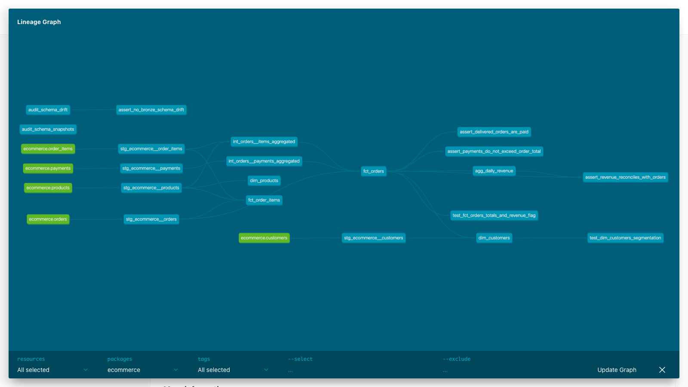

*The dbt lineage graph. Green boxes on the left are the BRONZE **sources**
(created by migrations); every blue box is a dbt **model** or **test**.*

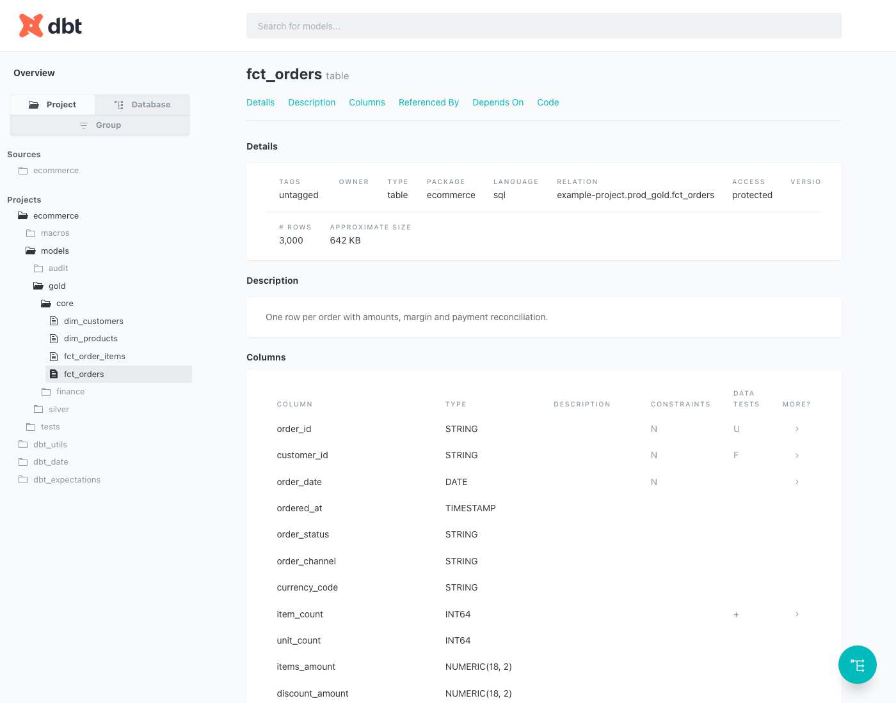

*dbt documentation of `fct_orders`: a model table built by dbt, with the column
types enforced by its contract (the project ID is replaced by `example-project`).*

### Git, pull requests and CI/CD

- **Git** keeps the history of every file. **GitHub** hosts it.
- A **pull request (PR)** proposes a change and lets people (and robots) review
  it before it is merged into the main branch.
- **CI** (continuous integration) automatically checks every PR.
- **CD** (continuous delivery) automatically deploys merged changes.
- **GitHub Actions** runs these automations. Each automation is a **workflow**
  (a YAML file in `.github/workflows`), made of **jobs**, made of **steps**.
- A GitHub **environment** (`dev`, `production`) can require a **manual approval**
  before a job runs. Here, production requires the owner's approval.

### Environments

The same code runs in several isolated copies, distinguished by a dataset prefix:

| Environment  | Datasets           | Purpose                                     | Lifetime          |
| ------------ | ------------------ | ------------------------------------------- | ----------------- |
| `dev`        | `dev_bronze`, …    | First deployment after a merge              | permanent         |
| `prod`       | `prod_bronze`, …   | What analysts use                           | permanent         |
| `pr_<number>`| `pr_7_bronze`, …   | Test one pull request in isolation          | dropped when the PR closes |

Pull request environments start as a **clone** of DEV: BigQuery copies tables
instantly and only charges for data that changes afterwards.

### Workload Identity Federation (keyless authentication)

GitHub Actions must prove to Google Cloud who it is. The old way is a
**service account key**: a password file stored in GitHub, which can leak.

This project uses **Workload Identity Federation (WIF)** instead:

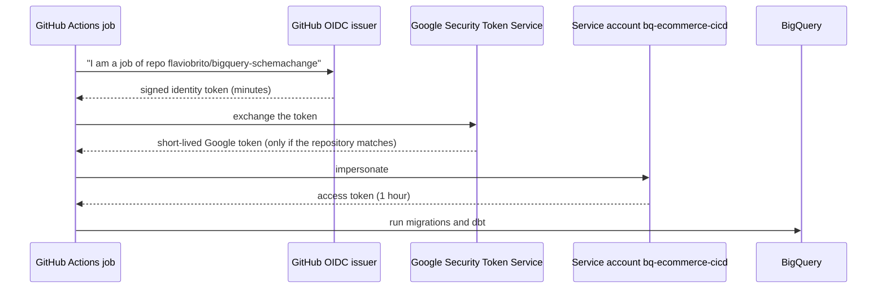

No password or key exists anywhere. Only workflows from **this repository** are
accepted; a fork or another repository is rejected.

---

## 3. How the pieces fit together

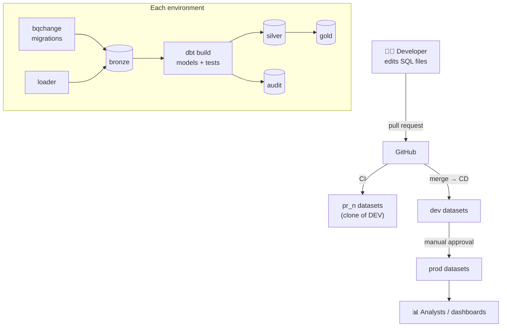

What happens inside **every** deployment, in order:

| # | Step                     | Tool       | Input                         | Expected outcome                                  |
| - | ------------------------ | ---------- | ----------------------------- | ------------------------------------------------- |
| 1 | Plan migrations          | bqchange   | `migrations/scripts/**`       | List of pending scripts, each validated by a BigQuery dry run (nothing changes) |
| 2 | Apply migrations         | bqchange   | pending scripts               | Datasets/tables changed; one row per script in `<env>_meta.change_history` |
| 3 | Load data (optional)     | ops loader | CSV files                     | Rows appended to BRONZE; one row per file in `<env>_audit.load_log` |
| 4 | Build and test           | dbt        | `dbt/models/**`, `dbt/tests/**` | SILVER and GOLD rebuilt; ~105 checks run; failures stored in `<env>_audit` |
| 5 | Report                   | ops report | change history, audit tables, dbt results | A Markdown report on the GitHub run page |

---

## 4. One-time setup

> You only do this once. Placeholders such as `<project>` stand for your own values.

### 4.1 Prerequisites

| Need                                   | Why                                    | Check                         |
| -------------------------------------- | -------------------------------------- | ----------------------------- |
| A Google Cloud project with billing    | BigQuery's free "sandbox" forbids the `MERGE` statements used here | `gcloud billing projects describe <project>` shows `billingEnabled: true` |
| `gcloud` CLI, logged in as project owner | Creates the service account and WIF | `gcloud auth list`            |
| `uv`                                   | Installs Python and all tools          | `uv --version`                |
| `gh` CLI with the `workflow` scope     | Stores secrets, pushes workflows        | `gh auth status`              |

**Cost:** the sample data is a few megabytes; queries, loads and clones stay
inside BigQuery's free tier. Every job is capped at 1 GiB billed
(`maximum_bytes_billed`), so a mistake cannot run up a bill.

### 4.2 Local installation

**Input**

```bash
git clone https://github.com/flaviobrito/bigquery-schemachange.git
cd bigquery-schemachange
make install
cp .env.example .env            # then edit GCP_PROJECT_ID
gcloud auth application-default login
```

**Expected outcome:** `make install` ends without errors; `make lint test-python`
prints `All checks passed!` and `46 passed`.

> Your local credentials are stored by `gcloud` in `~/.config/gcloud`, outside
> the repository. `.env` is ignored by Git. Nothing secret is ever committed.

### 4.3 Connect GitHub to Google Cloud

**Input**

```bash
GCP_PROJECT_ID=<project> GITHUB_REPOSITORY=<owner>/<repo> CONFIGURE_GITHUB=true \
  ./bootstrap/setup_gcp.sh
```

**Expected outcome**

```
==> Enabling APIs
==> Service account
Created service account [bq-ecommerce-cicd].
==> Workload Identity Federation
Created workload identity pool [github].
Created workload identity pool provider [github-oidc].
==> GitHub secrets and variables (<owner>/<repo>)
Done. Values are stored as secrets so they are masked in public workflow logs.
```

In GitHub, **Settings → Secrets and variables → Actions** now shows three
secrets (`GCP_PROJECT_ID`, `GCP_SERVICE_ACCOUNT`, `GCP_WORKLOAD_IDENTITY_PROVIDER`)
and one variable (`GCP_ENABLED = true`).

> **Why secrets and not variables?** Logs of a public repository are public, and
> dbt prints full table names (`<project>.dev_silver.…`). GitHub replaces secret
> values with `***` in logs, so the project ID never appears.

> **First run fails with `iam.serviceAccounts.getAccessToken denied`?** New
> permissions take a few minutes to propagate. Wait 3–5 minutes and press
> **Re-run failed jobs**.

### 4.4 Environments and approvals

In **Settings → Environments** create `ci`, `dev`, `production` and
`production-monitoring`. On `production`, tick **Required reviewers**, add
yourself, and under **Deployment branches** allow only `main`.

**Expected outcome:** every production deployment pauses with the message
*"Review pending deployments"* until a reviewer approves.

---

## 5. The pipelines, one by one

All workflows live in `.github/workflows`. Each card lists the trigger (when it
runs), the input (what it reads) and the expected outcome.

### 5.1 CI (`ci.yml`): checks every pull request

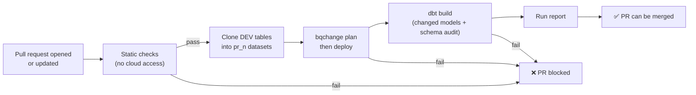

| | |
| --- | --- |
| **Trigger** | A pull request to `main` is opened or receives a new commit |
| **Input** | The files changed in the pull request; DEV's tables (cloned) and DEV's last dbt manifest |
| **Static checks** | Python lint + 52 unit tests, SQL lint, `dbt parse`, every migration rendered |
| **Integration** | Only the pull request's new migrations are applied to `pr_<n>`; dbt builds what changed (unchanged models are read from DEV) |
| **Expected outcome** | ✅ green when everything passes; ❌ red with the reason in the report otherwise |
| **Clean-up** | `pr-cleanup.yml` drops the `pr_<n>` datasets when the pull request is closed |

### 5.2 Deploy (`deploy.yml`): DEV, then PROD with approval

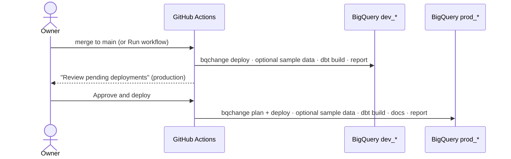

| | |
| --- | --- |
| **Trigger** | Push to `main` (merge), or **Actions → Deploy → Run workflow** |
| **Options** | *Load sample data* (generate and load synthetic data), *Full refresh* (rebuild incremental models) |
| **Input** | `migrations/`, `dbt/`, the `dev` and `prod` datasets |
| **Expected outcome** | DEV updates automatically; PROD waits for the owner's approval, then updates; the dbt documentation is attached to the run as an artifact |

The first production deployment applied every migration to an empty
environment ([run](https://github.com/flaviobrito/bigquery-schemachange/actions/runs/39883046028)):

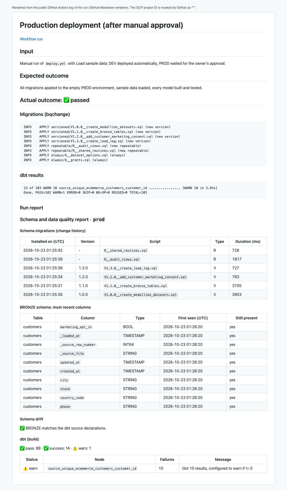

### 5.3 Data quality monitor (`monitor.yml`)

| | |
| --- | --- |
| **Trigger** | Manual (**Actions → Data quality monitor → Run workflow**, choose `prod` or `dev`). In a real production setup it would run on a daily schedule |
| **Input** | `prod_*` or `dev_*` datasets |
| **Steps** | Source freshness → refresh schema audit → report → schema drift alert (Slack/Teams if configured) → full test suite |
| **Expected outcome** | ✅ when data is fresh, the schema matches and all tests pass; ❌ with a drift alert when someone changed any layer outside the pipeline. On drift it stops **before** `dbt build`, so the evidence is not overwritten |

### 5.4 Data quality gate demo (`dq-gate-demo.yml`)

| | |
| --- | --- |
| **Trigger** | Manual |
| **Input** | A throwaway environment cloned from DEV, plus deliberately broken data |
| **Expected outcome** | ❌ always: it exists to show the gate stopping bad data (see scenario 4). The throwaway environment is dropped at the end |

## 6. The quality gate in action: five blocked changes

A quality gate is only credible if you can watch it say **no**. Each scenario
below was run for real in this repository. Full details, including the raw log
lines, are in [docs/evidence](evidence/README.md).

| # | Bad change | Stopped by | Result |
| - | ---------- | ---------- | ------ |
| 1 | New BRONZE column not declared in dbt | Schema drift audit | [PR #1](https://github.com/flaviobrito/bigquery-schemachange/pull/1): ❌ then ✅ after the fix |
| 2 | Revenue formula forgets shipping | Unit test | [PR #2](https://github.com/flaviobrito/bigquery-schemachange/pull/2): ❌ |
| 3 | Editing an applied migration | bqchange immutability rule | [PR #3](https://github.com/flaviobrito/bigquery-schemachange/pull/3): ❌ |
| 4 | Broken data arrives | SILVER data tests | [Run](https://github.com/flaviobrito/bigquery-schemachange/actions/runs/39885807472): ❌ |
| 5 | Manual `ALTER TABLE` on a GOLD table in BigQuery | Schema drift audit (all layers) | [Run](https://github.com/flaviobrito/bigquery-schemachange/actions/runs/39940900977): ❌ then ✅ after restore |

### Scenario 1: a new column nobody declared

| | |
| --- | --- |
| **Before** | `customers` in BRONZE has 14 columns, all declared in the dbt sources; drift audit aligned. |
| **What was done** | A migration `V1.4.0` adds `loyalty_tier`, without declaring it in dbt. |
| **After** | CI applies `V1.4.0` only in the pull request datasets, reports the column as `undeclared_in_dbt` and blocks the PR. After declaring the column, CI is green. |
| **Objective** | Every source column must be known to dbt, so documentation, tests and lineage never lag behind the database. |
| **Effect** | Undocumented structure can no longer reach DEV or PROD; the fix is a one-line YAML change shown in the report. |

**Story.** The store starts exporting a loyalty tier. A developer adds the
migration but forgets to tell dbt about the new column.

**Input:** `migrations/scripts/versioned/V1.4.0__add_customer_loyalty_tier.sql`

```sql
alter table `{{ project }}.{{ env }}_bronze.customers`
add column if not exists loyalty_tier string
options (description = 'Loyalty program tier: bronze | silver | gold');
```

**Expected outcome:** only `V1.4.0` is applied in `pr_1`; the drift audit lists
`customers.loyalty_tier` as `undeclared_in_dbt`; the test
`assert_no_bronze_schema_drift` fails; the pull request is red.

**Actual outcome:** exactly that. Note how the report shows the schema change
itself: `V1.4.0` in the change history and `loyalty_tier` as the newest BRONZE column.

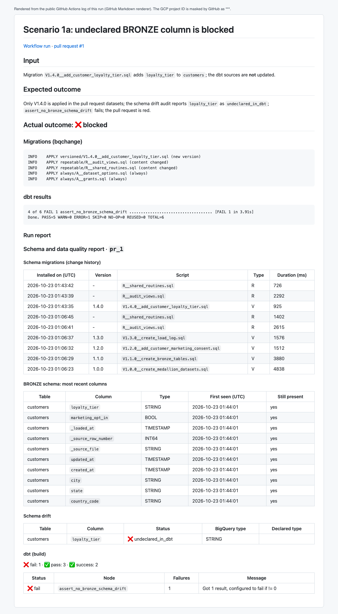

**The fix:** declare the column in `dbt/models/silver/ecommerce/_ecommerce__sources.yml`
(with a test for its allowed values) and push again. The pull request turns green:

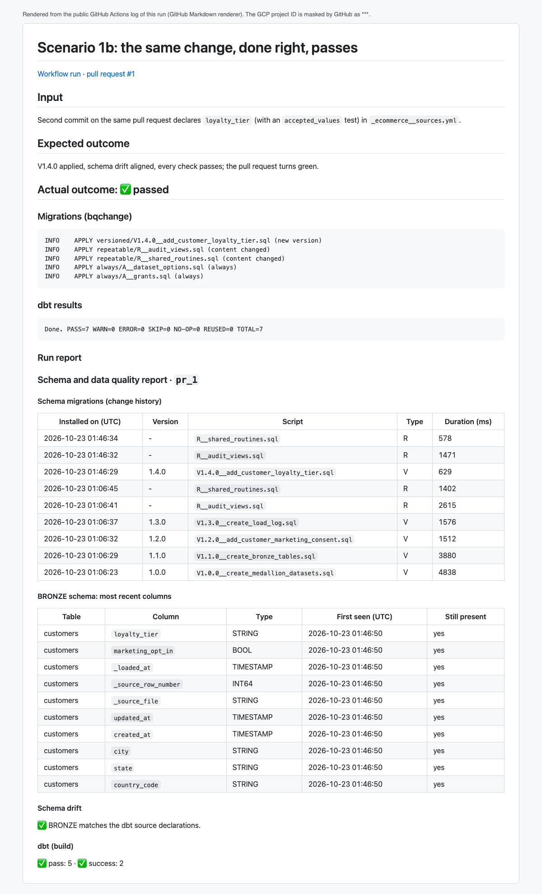

### Scenario 2: a wrong business rule

| | |
| --- | --- |
| **Before** | `order_total = items - discount + shipping`, covered by a unit test and an expression test. |
| **What was done** | The formula is edited to drop shipping. |
| **After** | The unit test fails before any table is built; 24 dependent nodes are skipped; the PR is blocked. |
| **Objective** | Business rules are encoded as tests, not tribal knowledge. |
| **Effect** | A revenue bug is caught in review, with the exact expected vs actual rows, instead of on a dashboard. |

**Story.** Someone decides shipping should not count in the order total and
edits `dbt/models/gold/core/fct_orders.sql`.

**Input:**

```diff
-        coalesce(items.items_amount, 0)
-        - orders.discount_amount
-        + orders.shipping_amount as order_total,
+        -- Simplify the total: shipping is billed separately.
+        coalesce(items.items_amount, 0)
+        - orders.discount_amount as order_total,
```

**Expected outcome:** the unit test feeds two known orders into the model and
compares the result with the documented rule
`order_total = items - discount + shipping`; it fails before any table is
built, and the 24 models and tests that depend on `fct_orders` are skipped.

**Actual outcome:**

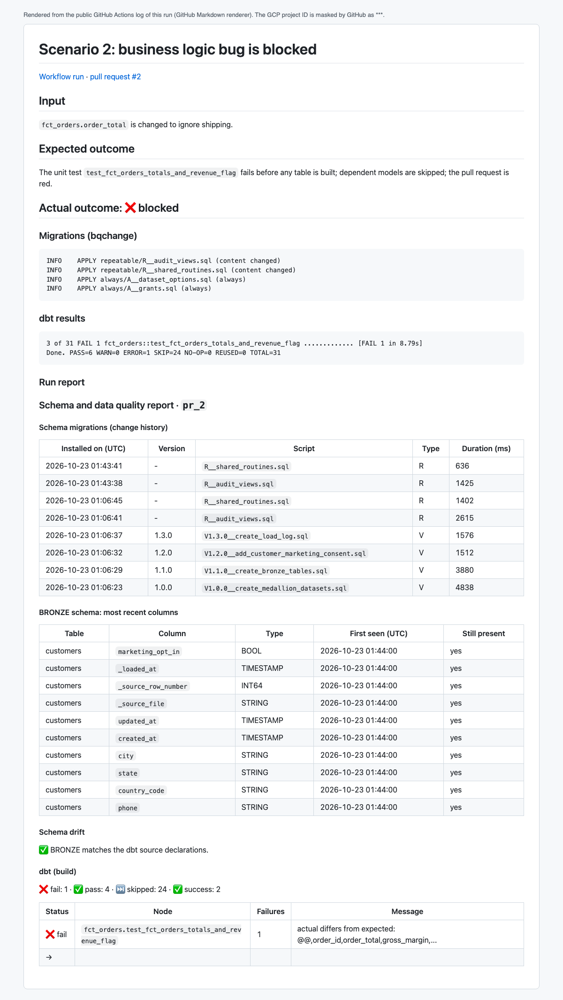

### Scenario 3: rewriting history

| | |
| --- | --- |
| **Before** | `V1.1.0` is applied in DEV and PROD; its checksum is stored in `change_history`. |
| **What was done** | The applied file is edited in place. |
| **After** | bqchange refuses to plan: "Versioned scripts are immutable: add a new version instead". Nothing is applied. |
| **Objective** | Git and every database must describe the same history. |
| **Effect** | Silent divergence between environments is impossible; the developer is told the correct procedure. |

**Story.** A developer adds a column description directly inside
`V1.1.0__create_bronze_tables.sql`, a migration that DEV and PROD already ran.

**Expected outcome:** bqchange compares the file's fingerprint (checksum) with
the one recorded when it was applied, refuses to continue and explains the
right way: a new version.

**Actual outcome:**


> Why so strict? DEV and PROD already contain the old version. Editing the file
> would make Git and the databases disagree silently; a new migration keeps
> every environment reproducible.

### Scenario 4: bad data arrives

| | |
| --- | --- |
| **Before** | DEV holds clean sample data; all checks pass. |
| **What was done** | Broken rows are loaded into a throwaway copy of DEV. |
| **After** | BRONZE warns (raw data is kept), SILVER fails with 3 errors, GOLD is skipped, the copy is dropped. |
| **Objective** | Bad source data must never reach business tables, but must not be lost either. |
| **Effect** | Analysts keep seeing the last good numbers; engineers get the failing rows stored in AUDIT. |

**Story.** The store's export contains problems: invalid emails, an order for a
customer who does not exist, a negative price and an unknown order status.

**Input:** `uv run python -m ops.generate_sample_data --inject-anomalies`,
loaded into a throwaway copy of DEV by `dq-gate-demo.yml`.

**Expected outcome:**

| Layer | Check | Severity | What happens |
| ----- | ----- | -------- | ------------ |
| BRONZE | invalid email, unknown status, orphan order, duplicates | `warn` | reported, the raw data is kept |
| SILVER | negative price, unknown status, order without customer | `error` | the pipeline **stops** |
| GOLD | — | — | models are **skipped**: bad data never reaches them |

**Actual outcome:** 8 warnings, 3 errors, 29 GOLD nodes skipped, environment dropped.

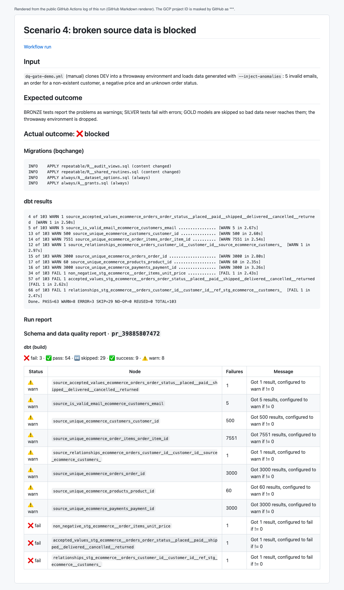

### Scenario 5: someone changes a table by hand

| | |
| --- | --- |
| **Before** | The schema drift audit covered BRONZE only. A manual `ALTER TABLE` on a SILVER or GOLD table went unnoticed and was silently overwritten by the next `dbt build` (or kept forever on the incremental model). |
| **What was done** | With the monitoring of every layer in place (see [section 8](#8-change-log-monitoring-every-layer)), a column is added by hand: `alter table dev_gold.dim_customers add column manual_note string`. |
| **After** | The monitor reports `GOLD dim_customers.manual_note ❌ undeclared_in_dbt`, sends the alert and stops before `dbt build`. After `dbt build` recreates the table from code, the monitor is green again. |
| **Objective** | Every change to the data platform must go through Git; changes made elsewhere must be visible, not silently erased. |
| **Effect** | Out-of-band changes are detected within one monitor run, with the exact table, column and layer. |

**Input:** in the BigQuery console (or `bq`), on the DEV environment:

```sql
alter table `<project>.dev_gold.dim_customers`
add column manual_note string options (description = 'Added by hand in the BigQuery console');
```

**Expected outcome:** monitor before the change ✅, after the change ❌ with the
column named, after `dbt build` ✅.

**Actual outcome:** before [run](https://github.com/flaviobrito/bigquery-schemachange/actions/runs/39935547618) ✅ ·
effect [run](https://github.com/flaviobrito/bigquery-schemachange/actions/runs/39940900977) ❌ · after [run](https://github.com/flaviobrito/bigquery-schemachange/actions/runs/39941074529) ✅.

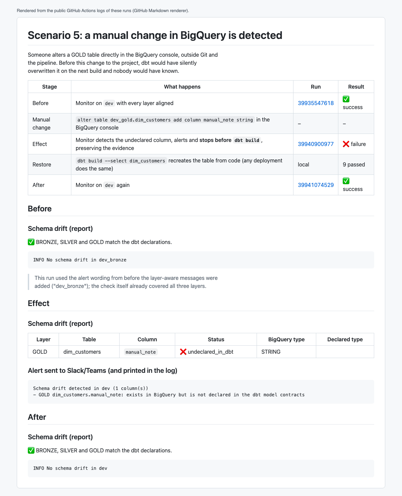

## 7. A pull request from opening to closing

A pull request (PR) is where a change is proposed, tested and decided. This is
the full life of one, using the real PRs of this repository.

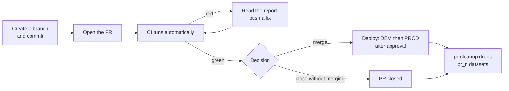

### 7.1 Open the pull request

| | |
| --- | --- |
| **You do** | Push a branch and open a PR to `main` (button *Compare & pull request* on GitHub, or `gh pr create`) |
| **What happens** | `ci.yml` starts: static checks, then the integration job in `pr_<n>` datasets |
| **Where to look** | The PR's *Conversation* tab: every commit shows ✅ or ❌, and the *Checks* tab lists each job |

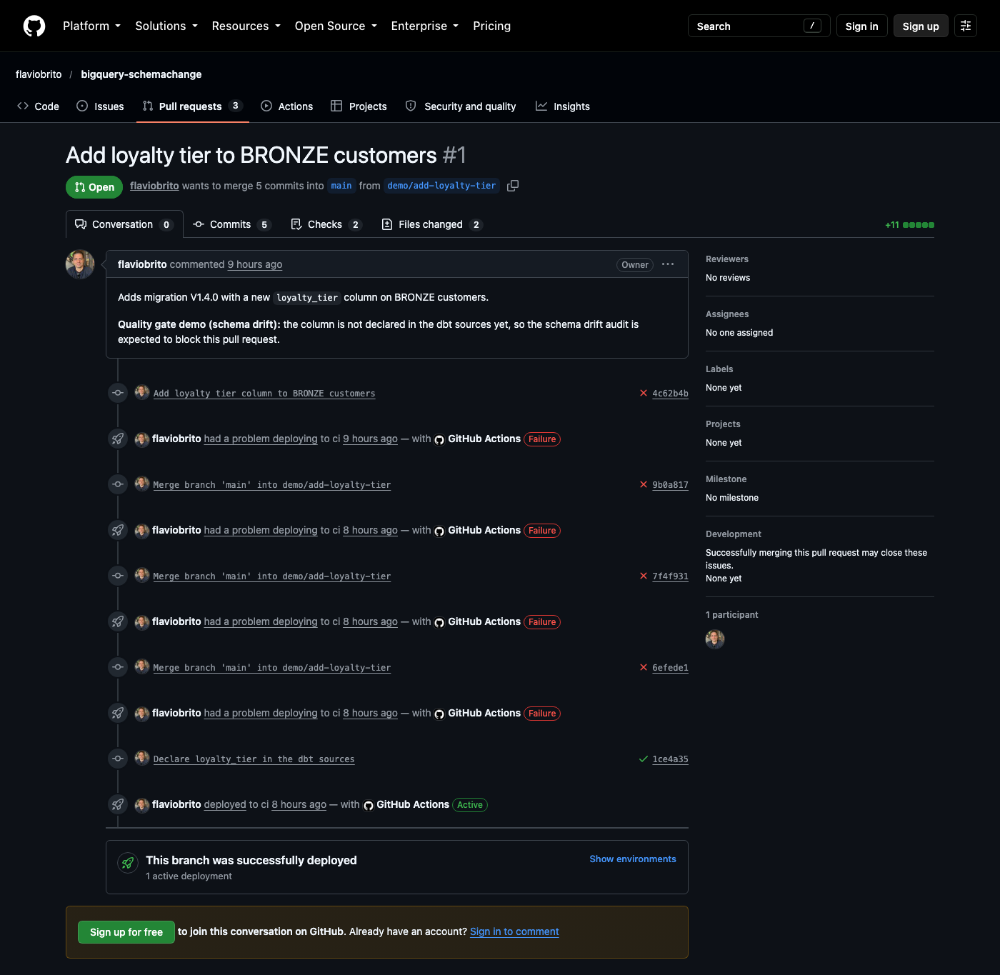

*PR #1: each commit and CI run is recorded in the timeline. Red crosses are
blocked attempts; the last commit, which declared the column, is green.*

### 7.2 Fix and push again

| | |
| --- | --- |
| **You do** | Read the run report (see [section 9](#9-reading-the-run-reports)), fix the cause, push a new commit to the same branch |
| **What happens** | CI runs again on the new commit; the PR shows the new result |

### 7.3 Merge, or close without merging

- **Merge** (green button *Merge pull request*) when CI is green and the change is wanted. The merge starts the deployment to DEV and asks for production approval.
- **Close** when the change should not go in. Demonstration PRs #2 and #3 were closed this way.

The **Close pull request** button is at the very bottom of the *Conversation*
tab, under the comment box, to the left of *Comment*. It is only visible to
signed-in users with write access to the repository:

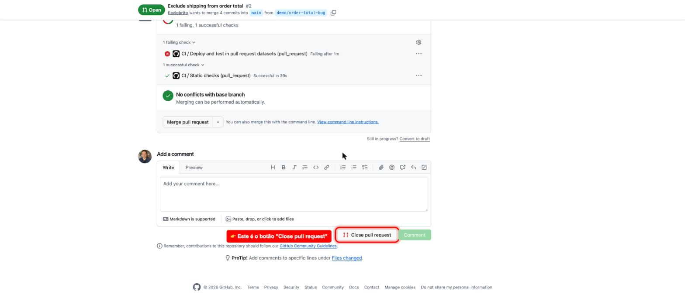

*Optionally write a comment first (for example, why it was closed), then click
**Close pull request**.*

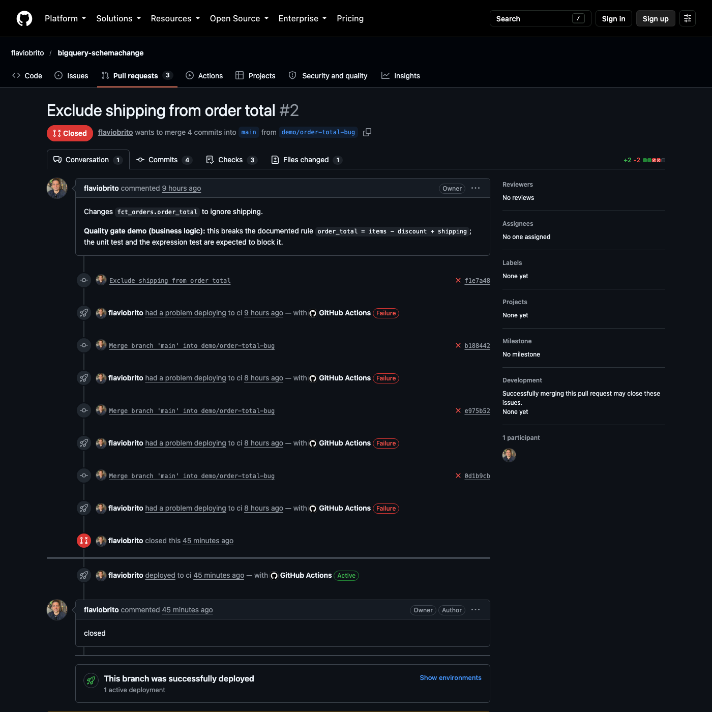

*The PR is marked **Closed**, the closing event and comment are kept in the
timeline, and the branch stays available for reference.*

### 7.4 Automatic clean-up

| | |
| --- | --- |
| **Trigger** | A PR is closed (merged or not) |
| **Workflow** | `pr-cleanup.yml` |
| **Effect** | The `pr_<n>_bronze`, `_silver`, `_gold`, `_audit` and `_meta` datasets are deleted. Only datasets named `pr_<number>_*` can be deleted by this workflow |

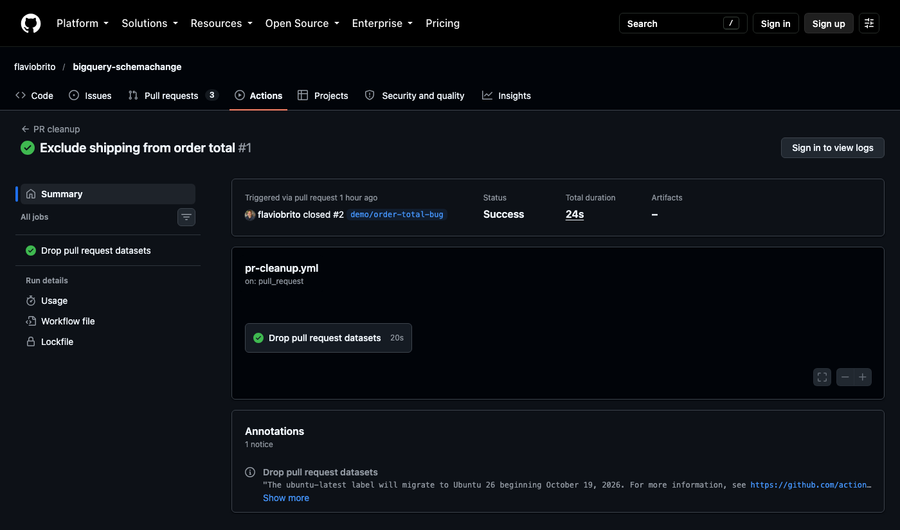

*The clean-up run started by closing PR #2: one job, "Drop pull request datasets", finished in 24 seconds.*

## 8. Change log: monitoring every layer

### Part 1: detect drift in every layer

The first version of this project watched the schema of **BRONZE only**. A
question during the showcase ("what if someone changes a SILVER or GOLD
table?") exposed the gap, and [PR #4](https://github.com/flaviobrito/bigquery-schemachange/pull/4) closed it.

| | |
| --- | --- |
| **Before** | Code changes: GOLD protected by contracts; SILVER only partially (columns with tests). Manual `ALTER TABLE` in SILVER/GOLD: **not detected**; silently overwritten by the next `dbt build`, or kept forever on the incremental `stg_ecommerce__orders`. The drift audit compared BRONZE only |
| **What was done** | 1) Contracts on every SILVER model (all columns typed, `numeric(18, 2)` precision). 2) `audit_schema_snapshots` and `audit_schema_drift` read the `INFORMATION_SCHEMA` of BRONZE, SILVER and GOLD and compare them with dbt sources and model contracts; each row has a `layer`. 3) New test `assert_no_model_schema_drift`. 4) dbt's transient tables (`__dbt_tmp`, `__dbt_backup`) are ignored, so an incremental merge running at the same time is not reported as drift. 5) The monitor can target `dev` or `prod`, has its own queue (a deployment waiting for approval no longer blocks it) and alerts name the layer and the missing declaration |
| **After** | Code changes: blocked by contracts in SILVER and GOLD. Manual changes in any layer: detected by the monitor, alerted, and the build is stopped before it can overwrite the evidence |
| **Objective** | Every structural change, wherever it is made, is either reviewed in Git or reported |
| **Effect** | Validated on DEV: 71 checks passed with drift aligned on all three layers; scenario 5 shows a manual change detected and resolved |

### Part 2: a schema history for every layer

| | |
| --- | --- |
| **Before** | Only BRONZE had a history: `change_history` records which migration ran, but not what SILVER and GOLD looked like over time. A changed SILVER/GOLD column left no trace once dbt rebuilt the table |
| **What was done** | `bqchange record-schema` snapshots the columns of BRONZE, SILVER and GOLD after each step of a deployment, compares by layer with the previous snapshot and writes one row per change in `<env>_meta.schema_change_log`, with its source (`migration`, `dbt` or `manual`), commit, pull request, run and actor. The view `<env>_audit.schema_history` and the run report show the timeline |
| **After** | One timeline answers "what changed in the schema, where, when, and because of which change?" for all layers |
| **Objective** | The migration tool remains the single place to audit schema evolution, even for the tables dbt owns |
| **Effect** | Validated on DEV: baseline of 181 columns recorded; later runs without changes record nothing; manual changes are labelled `manual` |

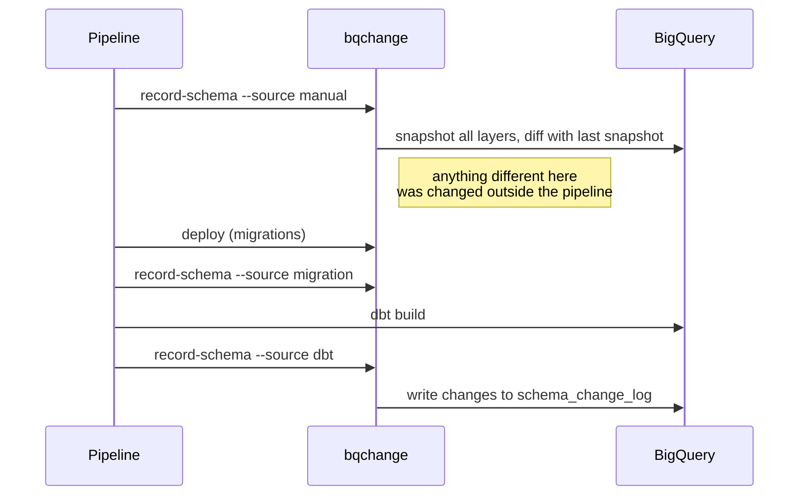

Example of the resulting timeline (`<env>_audit.schema_history`):

| When | Layer | Table | Column | Change | Source | PR |
| --- | --- | --- | --- | --- | --- | --- |
| 10:41 | BRONZE | customers | `loyalty_tier` | added | migration | #1 |
| 11:02 | GOLD | fct_orders | `gross_margin` | type changed | dbt | #5 |
| 11:30 | GOLD | dim_customers | `manual_note` | added | manual | |

How the audit decides, for each column it finds:

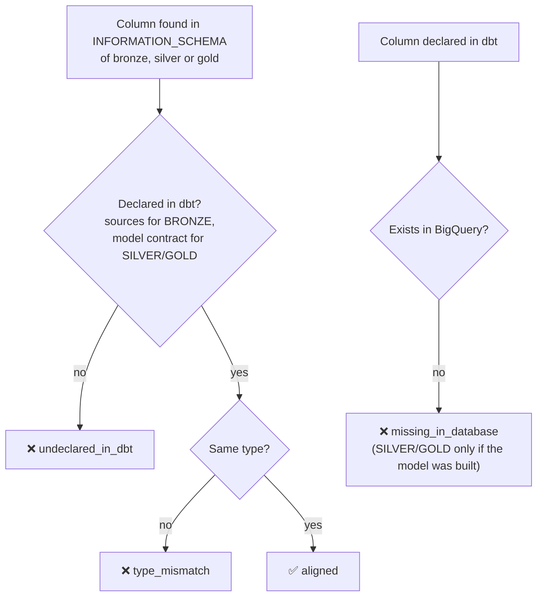

## 9. Reading the run reports

Every integration, deploy and monitor run ends with a **Schema and data quality
report**, written to the run's *Summary* page (visible to signed-in GitHub users;
the same text is printed in the step log). It has four parts:

| Section | Answers | Source |
| ------- | ------- | ------ |
| **Schema migrations** | Which structural changes were applied, when, and how long they took? | `<env>_audit.deployment_history` (view over the change history) |
| **Schema: most recent columns** | What do BRONZE, SILVER and GOLD look like now, and which columns are new or were dropped? | `<env>_audit.audit_schema_snapshots` |
| **Schema drift** | Do BigQuery and the dbt declarations agree, in every layer? | `<env>_audit.audit_schema_drift` |
| **dbt** | How many checks passed, warned or failed, and which ones? | `dbt/target/run_results.json` |

How to read the icons:

| Icon | Meaning |
| ---- | ------- |
| ✅ | passed |
| ⚠️ | warning: reported, did not stop the pipeline |
| ❌ | failed: stopped the pipeline |
| ⏭️ | skipped because something it depends on failed |
| ⏳ (plan only) | cannot be validated yet because an earlier pending migration creates what it needs |

> A section that says **"⚠️ Not available"** means the query behind it failed.
> It is never shown as ✅: an unverified check is not a passed check.

The same information is queryable in BigQuery at any time:

```sql
select * from `<project>.prod_audit.deployment_history`;   -- migrations applied
select * from `<project>.prod_audit.audit_schema_drift`
where drift_status != 'aligned';                          -- current drift
select * from `<project>.prod_audit.load_summary`;          -- data loaded per day
```

## 10. Day-to-day workflow

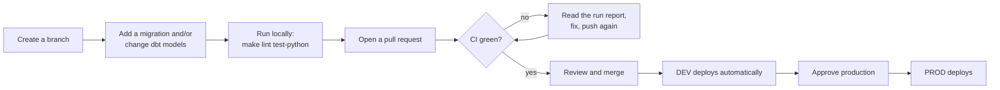

### Adding a column, the right way

| # | You do                                                                 | Expected outcome |
| - | ---------------------------------------------------------------------- | ---------------- |
| 1 | Create `migrations/scripts/versioned/V1.5.0__add_<something>.sql` with `alter table ... add column if not exists ...` | `uv run bqchange render versioned/V1.5.0__....sql` prints the SQL with your environment's dataset names |
| 2 | Declare the column in `dbt/models/silver/ecommerce/_ecommerce__sources.yml` (name and `data_type`) | `make lint` passes |
| 3 | Use the column in a SILVER model if needed, and add tests              | `make lint` passes |
| 4 | Open a pull request                                                    | CI applies **only** `V1.5.0` in `pr_<n>` datasets, schema drift is ✅, tests pass |
| 5 | Merge, then approve production                                         | `V1.5.0` appears in the DEV and PROD change history and in the run reports |

### Rules of thumb

- Never edit a versioned script that was merged: add a new version.
- Every BRONZE column must be declared in the dbt sources.
- Prefer `if not exists` / `if exists` in migrations so they are safe to re-run.
- A red pipeline is the system working: read the report before retrying.

## 11. Troubleshooting

| Symptom (where)                                         | Cause                                                       | Fix |
| ------------------------------------------------------- | ----------------------------------------------------------- | --- |
| `Permission 'iam.serviceAccounts.getAccessToken' denied` (first CI/deploy run) | Workload Identity permissions take minutes to propagate after `setup_gcp.sh` | Wait 3–5 minutes, then **Re-run failed jobs** |
| `... was already applied and has been modified. Versioned scripts are immutable` | Someone edited an applied `V` script | Revert the edit and put the change in a new `V` script |
| `... is older than the latest applied version`          | A new script has a version lower than one already applied   | Rename it to the next version, or deploy with `--out-of-order` |
| `assert_no_bronze_schema_drift` fails                    | BRONZE and the dbt sources disagree                         | Open the run report's *Schema drift* table; declare or remove the column |
| `assert_no_model_schema_drift` fails / monitor alert on SILVER or GOLD | A table was changed outside dbt, or a contract is stale | Rebuild the model (`dbt build --select <model>`) to revert, or make the change official in the model and its contract |
| Monitor stays *Queued*                                   | Fixed: it used to share the deployment queue and waited behind a deployment pending approval | Each environment now has its own monitor queue |
| `Not found: Table ...dev_audit...` while cloning (CI)   | A DEV deployment replaced audit tables while CI was copying them | Fixed: only stateful AUDIT tables are cloned and vanished tables are skipped; re-run the job |
| `Access Denied: ... bigquery.jobs.create` (local)       | Application Default Credentials belong to another account    | `gcloud auth application-default login --project <project>` |
| `Query exceeded limit for bytes billed`                  | A job would read more than 1 GiB                            | Intended protection; filter the query or raise `maximum-bytes-billed` consciously |
| Deployment waits forever                                 | The `production` environment needs approval                 | Open the run → **Review deployments** → approve or reject |
| Jobs that need Google Cloud are *skipped*                | `GCP_ENABLED` is not `true` or the PR comes from a fork      | Set the variable; forks never receive credentials by design |

### Lessons from building this showcase

Real problems found and fixed while running the pipelines. They are kept here because they explain design decisions:

1. **Checksums must not depend on the environment.** Migrations contain the
   environment's dataset names (`{{ env }}_bronze`). Computing the immutability
   checksum on the *rendered* SQL made every pull request clone look like an
   edited migration. Versioned scripts are now fingerprinted on the raw file;
   rows written in the old format are upgraded automatically, once.
2. **dbt's temporary tables are not drift.** An incremental model is merged
   through a temporary `__dbt_tmp` table. When the drift test ran at the same
   moment, it reported that table as undeclared. dbt's transient relations are
   now ignored by the audit.
3. **Clones race with deployments.** Copying every AUDIT table failed when a DEV
   deployment recreated the stored test failures at the same moment. Only tables
   with history are cloned now, and tables that disappear mid-copy are skipped.

## 12. Glossary

| Term                     | Meaning |
| ------------------------ | ------- |
| **ADC**                  | Application Default Credentials: the login that Google libraries use on your machine (`gcloud auth application-default login`) |
| **Approval / reviewer**  | A person who must click *Approve* before a protected GitHub environment runs |
| **BRONZE / SILVER / GOLD** | Raw, cleaned and business-ready layers of the medallion architecture |
| **Change history**       | Table recording every applied migration with its checksum and time (`<env>_meta.change_history`) |
| **Checksum**             | A fingerprint of a file; any edit changes it |
| **CI / CD**              | Automatic checks on every change / automatic deployment after merge |
| **Clone (table clone)**  | An instant, copy-on-write copy of a BigQuery table |
| **Contract**             | A declared list of columns and types a dbt model must produce |
| **Dataset**              | A BigQuery folder of tables, views and functions |
| **dbt**                  | The tool that builds SILVER and GOLD from SQL and tests them |
| **Defer**                | dbt reuses DEV tables for models a pull request did not change |
| **Dry run**              | BigQuery validates a query and estimates its cost without running it |
| **Environment**          | An isolated copy of all datasets (`dev`, `prod`, `pr_<n>`) |
| **Incremental model**    | A dbt table that only processes new rows on each run |
| **INFORMATION_SCHEMA**   | BigQuery's built-in catalogue of tables and columns |
| **Job summary**          | The Markdown report shown on a GitHub Actions run page |
| **Lineage**              | The graph of which table feeds which |
| **Migration**            | A versioned SQL file that changes the database structure |
| **OIDC**                 | The open standard GitHub uses to issue identity tokens to workflows |
| **Pull request (PR)**    | A proposed change, reviewed and tested before merging |
| **Schema**               | The structure of the data: tables, columns, types |
| **Schema drift**         | Disagreement between the real schema and the declared one |
| **Secret (GitHub)**      | An encrypted value available to workflows and masked as `***` in logs |
| **Service account**      | A non-human Google identity used by automation |
| **Severity (warn/error)**| Whether a failed check is reported only or stops the pipeline |
| **Unit test (dbt)**      | Fake input rows → model → compared with expected output rows |
| **Workflow / job / step**| A GitHub Actions automation / a group of steps on one machine / one command |
| **Workload Identity Federation** | Keyless authentication: GitHub's identity token is exchanged for short-lived Google credentials |
