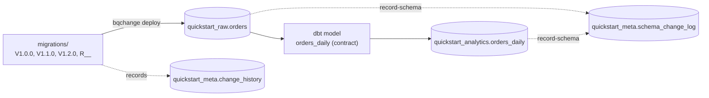
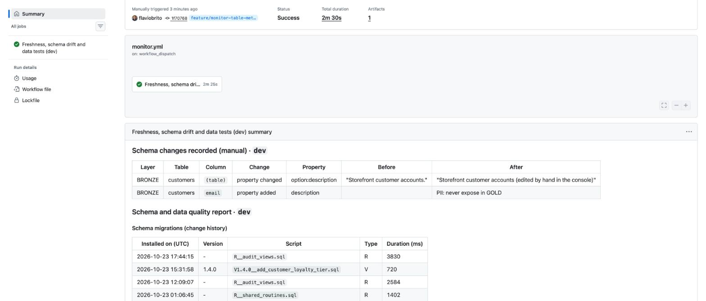
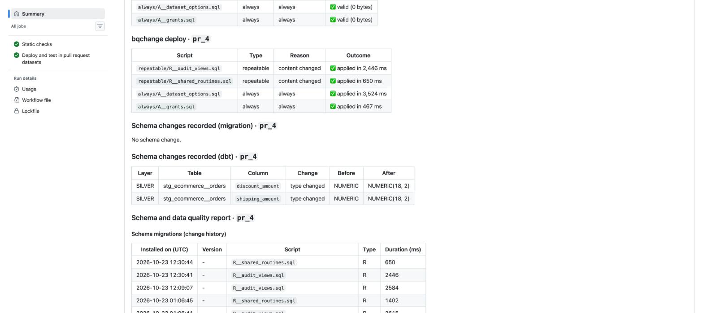
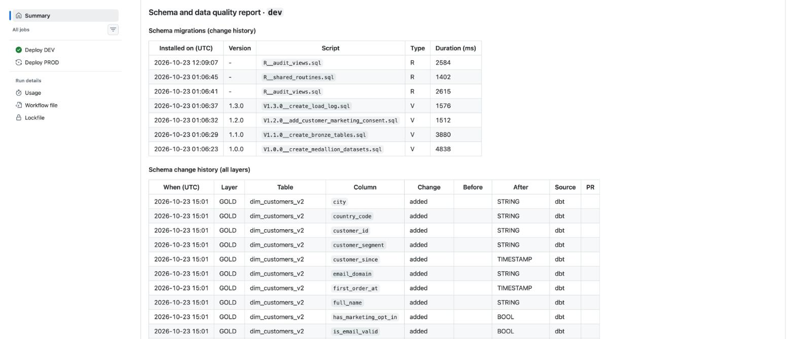
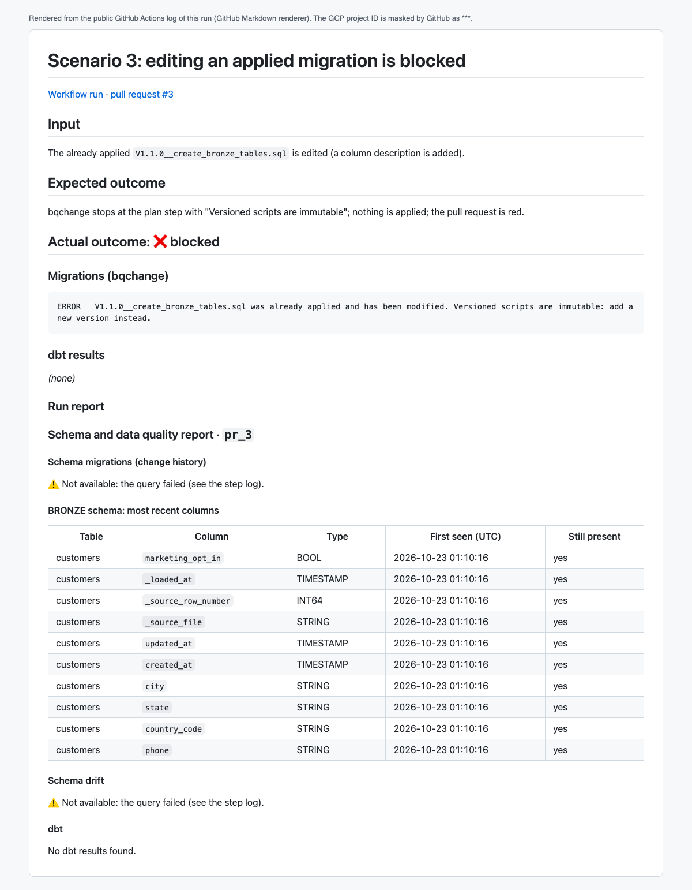

# Quickstart: bqchange in 15 minutes

Install **bqchange**, apply your first BigQuery migrations, connect a dbt model
and see every schema change recorded. Each step shows the command and the
output you should get. Every output below comes from a real run.

> Want the concepts first? Read the [complete guide](guide.md). Want CI/CD?
> See [step 9](#9-next-run-it-in-github-actions).

**What you will build**



| Dataset | Created by | Content |
| --- | --- | --- |
| `quickstart_raw` | your migrations | `orders` table |
| `quickstart_analytics` | your repeatable script and dbt | `recent_orders` view, `orders_daily` table |
| `quickstart_meta` | bqchange itself | `change_history`, `schema_change_log`, `schema_state` |

---

## 1. Prerequisites (2 min)

| You need | Check |
| --- | --- |
| A GCP project with billing enabled (the BigQuery sandbox forbids DML) | `gcloud billing projects describe <project>` → `billingEnabled: true` |
| `gcloud` CLI | `gcloud --version` |
| [`uv`](https://docs.astral.sh/uv/) | `uv --version` |

Log in once. The credentials stay in `~/.config/gcloud`, outside your project:

```bash
gcloud auth application-default login --project <project>
```

> **Cost:** everything here is a few kilobytes and stays in the free tier. bqchange
> refuses any job that would bill more than `maximum-bytes-billed` (1 GiB below).

## 2. Install bqchange (1 min)

```bash
uv init my-warehouse && cd my-warehouse
uv add git+https://github.com/flaviobrito/bigquery-schemachange
uv run bqchange --version
```

Expected output:

```text
bqchange 1.0.0
```

The package also installs `dbt-core` and `dbt-bigquery`, used in step 7.

## 3. Configure (2 min)

Create `migrations/bqchange.yml`:

```yaml
project: "{{ env_var('GCP_PROJECT_ID') }}"
location: US
root-folder: scripts
change-history-table: "{{ env_var('BQ_ENV') }}_meta.change_history"
maximum-bytes-billed: 1073741824   # 1 GiB per job

# Your layers: any names you like (medallion, staging/marts, Data Vault...)
layers:
  raw: "{{ env_var('BQ_ENV') }}_raw"
  analytics: "{{ env_var('BQ_ENV') }}_analytics"
schema-log-layers: [raw, analytics]

vars:
  env: "{{ env_var('BQ_ENV') }}"
```

Set the environment. `BQ_ENV` prefixes every dataset, so `dev`, `prod` and a
`quickstart` sandbox never collide:

```bash
export GCP_PROJECT_ID=<project>
export BQ_ENV=quickstart
mkdir -p migrations/scripts/{versioned,repeatable,always}
```

Check that everything is in place before writing any script:

```bash
uv run bqchange verify
```

```text
Checks
  ✅ credentials          user credentials (gcloud auth application-default login)
  ✅ run jobs             dry-run job in <project>
  ✅ root-folder          .../migrations/scripts
  ⚠️ layer raw            quickstart_raw does not exist yet (a migration may create it)
  ⚠️ layer analytics      quickstart_analytics does not exist yet (a migration may create it)
  ⚠️ change history       <project>.quickstart_meta.change_history will be created by the first deploy
```

Warnings are expected on a fresh environment; a ❌ would stop you here with the reason.
Every setting can also come from flags or `BQCHANGE_*` variables
([priority](bqchange.md#priority)).

> No credentials go in this file. Commit it.

## 4. Write your first migrations (2 min)

A migration is a SQL file that changes the database **structure**; bqchange runs
each one once, in order, and records it. You only need migrations for what dbt
does **not** build: datasets, source/landing tables, functions, grants. Your dbt
models never need one (dbt creates a table per model file). Only these scripts
live under `migrations/scripts/`; the rest of your project stays where it is.
See [the README](../README.md#migrations-what-they-are-and-when-you-need-one) for the full explanation.

The three script types, recognised **by file name**:

| File name | Runs | Use it for |
| --- | --- | --- |
| `V<version>__<name>.sql` | once, in version order (compared as numbers: `V1.10` after `V1.2`); never edit after it ran | datasets, tables, `alter table` |
| `R__<name>.sql` | whenever the file changes | views, functions |
| `A__<name>.sql` | on every deployment | grants, labels |

`migrations/scripts/versioned/V1.0.0__create_raw_orders.sql`:

```sql
create schema if not exists `{{ project }}.{{ layers.raw }}` options (location = '{{ location }}');

create table if not exists `{{ project }}.{{ layers.raw }}.orders` (
    order_id string not null,
    customer_id string,
    amount numeric,
    ordered_at timestamp
);
```

`migrations/scripts/versioned/V1.1.0__add_order_status.sql`:

```sql
alter table `{{ project }}.{{ layers.raw }}.orders`
add column if not exists status string;
```

`migrations/scripts/repeatable/R__orders_view.sql`:

```sql
create schema if not exists `{{ project }}.{{ layers.analytics }}` options (location = '{{ location }}');

create or replace view `{{ project }}.{{ layers.analytics }}.recent_orders` as
select * from `{{ project }}.{{ layers.raw }}.orders`
where ordered_at >= timestamp_sub(current_timestamp(), interval 30 day);
```

Check what a script will really run, offline:

```bash
uv run bqchange render versioned/V1.0.0__create_raw_orders.sql
```

```text
create schema if not exists `<project>.quickstart_raw` options (location = 'US');

create table if not exists `<project>.quickstart_raw.orders` (
    order_id string not null,
    ...
```

## 5. Plan, then deploy (2 min)

**Plan** (BigQuery dry runs, nothing is changed):

```bash
uv run bqchange deploy --dry-run
```

```text
INFO    Change history table not found: every script is pending
INFO    PLAN  versioned/V1.0.0__create_raw_orders.sql (new version) - valid, 0 bytes
WARNING PLAN  versioned/V1.1.0__add_order_status.sql (new version) - not validated yet: Not found: Dataset <project>:quickstart_raw was not found in location US
INFO    PLAN  repeatable/R__orders_view.sql (new repeatable) - valid, 0 bytes
```

The warning is expected: `V1.1.0` alters a table that `V1.0.0` has not created yet.

**Deploy:**

```bash
uv run bqchange deploy
```

```text
INFO    APPLY versioned/V1.0.0__create_raw_orders.sql (new version)
INFO    APPLY versioned/V1.1.0__add_order_status.sql (new version)
INFO    APPLY repeatable/R__orders_view.sql (new repeatable)
```

**Run it again:** nothing happens. Deployments are idempotent.

```text
INFO    Nothing to deploy: <project>.quickstart_meta.change_history is up to date
```

**Take the first schema snapshot** (the baseline every later change is compared with):

```bash
uv run bqchange record-schema --source migration
```

```text
INFO    Recorded 10 schema change(s) from migration
```

Those 10 rows are the baseline (`change_type = 'baseline'`): the columns of
`orders` and of the `recent_orders` view. From now on only differences are recorded.

✅ **Checkpoint:** in BigQuery, `quickstart_raw.orders` exists with 5 columns
(`order_id`, `customer_id`, `amount`, `ordered_at`, `status`), and:

```sql
select version, script, script_type, status, installed_on
from `<project>.quickstart_meta.change_history`
order by installed_on;
```

| version | script | script_type | status |
| --- | --- | --- | --- |
| 1.0.0 | V1.0.0__create_raw_orders.sql | V | success |
| 1.1.0 | V1.1.0__add_order_status.sql | V | success |
| - | R__orders_view.sql | R | success |

## 6. Evolve the schema safely (2 min)

**Try to edit an applied migration** (for example, change `amount numeric` to
`numeric(18, 2)` inside `V1.0.0`), then deploy:

```text
ERROR   V1.0.0__create_raw_orders.sql was already applied and has been modified. Versioned scripts are immutable: add a new version instead.
```

Nothing was applied. Undo the edit and do it the right way, with a **new version**,
`migrations/scripts/versioned/V1.2.0__add_order_channel.sql`:

```sql
alter table `{{ project }}.{{ layers.raw }}.orders`
add column if not exists channel string options (description = 'web | app | store');
```

```bash
uv run bqchange deploy
uv run bqchange record-schema --source migration
```

```text
INFO    APPLY versioned/V1.2.0__add_order_channel.sql (new version)
INFO    Recorded 1 schema change(s) from migration
```

> `record-schema` takes a snapshot of every layer in `schema-log-layers` and logs
> what changed since the previous snapshot: here, the new `channel` column.

## 7. Add a dbt model (3 min)

Migrations own the **raw** tables (they hold data you cannot rebuild). dbt owns
the **models** (one table per `.sql` file, rebuilt on every run). The raw table
becomes a dbt `source`.

`dbt/dbt_project.yml`:

```yaml
name: my_warehouse
version: "1.0.0"
config-version: 2
profile: my_warehouse
model-paths: ["models"]
models:
  my_warehouse:
    +materialized: table
```

`dbt/profiles.yml` (no credentials: `oauth` uses your gcloud login):

```yaml
my_warehouse:
  target: dev
  outputs:
    dev:
      type: bigquery
      method: oauth
      project: "{{ env_var('GCP_PROJECT_ID') }}"
      dataset: "{{ env_var('BQ_ENV') }}_analytics"
      location: US
      threads: 4
      maximum_bytes_billed: 1073741824
```

`dbt/models/sources.yml`: declare every column the migrations created:

```yaml
version: 2
sources:
  - name: raw
    schema: "{{ env_var('BQ_ENV') }}_raw"
    tables:
      - name: orders
        columns:
          - {name: order_id, data_type: string, data_tests: [not_null, unique]}
          - {name: customer_id, data_type: string}
          - {name: amount, data_type: numeric}
          - {name: ordered_at, data_type: timestamp}
          - {name: status, data_type: string}
          - {name: channel, data_type: string}
```

`dbt/models/orders_daily.sql`:

```sql
select
    date(ordered_at) as order_date,
    channel,
    count(*) as order_count,
    sum(amount) as revenue
from {{ source('raw', 'orders') }}
group by order_date, channel
```

`dbt/models/orders_daily.yml`: a **contract** makes the output structure explicit:

```yaml
version: 2
models:
  - name: orders_daily
    config:
      contract: {enforced: true}
    columns:
      - {name: order_date, data_type: date}
      - {name: channel, data_type: string}
      - {name: order_count, data_type: int64}
      - {name: revenue, data_type: numeric}
```

Build it and record what dbt changed:

```bash
uv run dbt build --project-dir dbt --profiles-dir dbt
uv run bqchange record-schema --source dbt
```

```text
1 of 3 PASS source_not_null_raw_orders_order_id ................................ [PASS]
2 of 3 PASS source_unique_raw_orders_order_id .................................. [PASS]
3 of 3 OK created sql table model quickstart_analytics.orders_daily ............ [CREATE TABLE]
Done. PASS=3 WARN=0 ERROR=0 SKIP=0 NO-OP=0 REUSED=0 TOTAL=3
INFO    Recorded 4 schema change(s) from dbt
```

## 8. See the schema history (1 min)

Every structural change, in every layer, with **who** made it:

```sql
select changed_at, source, change_type, layer, table_name, column_name, new_data_type
from `<project>.quickstart_meta.schema_change_log`   -- also has property, old_value, new_value
where change_type != 'baseline'
order by changed_at;
```

| source | change_type | layer | table_name | column_name | new_data_type |
| --- | --- | --- | --- | --- | --- |
| migration | added | raw | orders | channel | STRING |
| dbt | added | analytics | orders_daily | channel | STRING |
| dbt | added | analytics | orders_daily | order_count | INT64 |
| dbt | added | analytics | orders_daily | order_date | DATE |
| dbt | added | analytics | orders_daily | revenue | NUMERIC |

This log is **not limited to your migrations**: it covers every table and view
of the datasets in `schema-log-layers`, whoever created them. Besides columns it
tracks table and column **properties**: partitioning, clustering, table options
(description, labels, expiration…) and column descriptions.

Sources: `migration` (bqchange scripts), `dbt` (models) and `manual`: run
`record-schema --source manual` **before** a deployment and anything changed by
hand in the BigQuery console shows up with that label. For example, after editing
a table description in the console:



🎉 **Done.** You have versioned migrations, a dbt model under contract, and a
complete schema history.

## 9. Next: run it in GitHub Actions

In CI the same commands run on every pull request and deployment, and each run
page shows what was applied and what changed:



*A pull request run: the scripts bqchange applied (with the reason), then the
schema changes recorded after migrations and after dbt.*



*A deployment summary: the accumulated schema history of the environment, by layer, with source and pull request.*

The quality gate blocks bad changes before they merge. For example, an edited migration:



To set this up (keyless authentication, environments, approvals), follow
[the runbook](runbook.md) and copy `.github/workflows` from this repository.

## Command cheat sheet

| Command | What it does |
| --- | --- |
| `bqchange verify` | Check configuration, credentials and permissions (secrets masked) |
| `bqchange render <path>` | Print a script with variables filled in, secrets masked (offline) |
| `bqchange deploy --dry-run` | Plan: list and validate pending scripts, change nothing |
| `bqchange deploy` | Apply pending scripts and record them in `change_history` |
| `bqchange deploy --out-of-order` | Allow a version older than the latest applied one |
| `bqchange record-schema --source manual\|migration\|dbt` | Log column changes since the last snapshot |
| `bqchange --config path/to/bqchange.yml ...` | Use another config file |

## Troubleshooting

| Message | Fix |
| --- | --- |
| `Environment variable BQ_ENV is not set` | `export BQ_ENV=quickstart` (and `GCP_PROJECT_ID`) |
| `Access Denied: ... bigquery.jobs.create` | `gcloud auth application-default login --project <project>` |
| `Versioned scripts are immutable` | Revert the edit; put the change in a new `V` file |
| `... is older than the latest applied version` | Give the new file the next version number |
| `Query exceeded limit for bytes billed` | Protection working: narrow the query or raise `maximum-bytes-billed` |
| `schema-log-layers not declared in layers` | Every name in `schema-log-layers` must be a key of `layers` |

## Clean up

The quickstart created three datasets. Remove them when you are done:

```bash
bq rm -r -f -d <project>:quickstart_raw
bq rm -r -f -d <project>:quickstart_analytics
bq rm -r -f -d <project>:quickstart_meta
```
